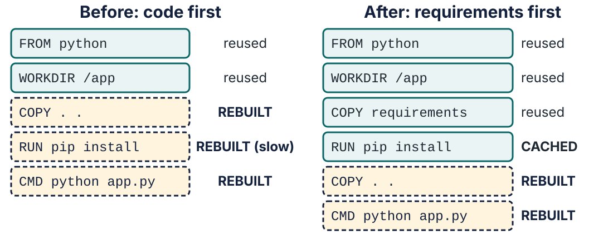

# Lecture 5 · Demo 2: Package the Menu

**Mastering Computer Science Technical Competencies** · Lecture 5: A Box That Just Runs

---

## The Scenario So Far

Tom needs a **box that just runs**. You know how to use other people's boxes
([Demo 1](Lecture-5-Demo-1-Run-Other-Peoples-Software.md)). Now you'll make
your own for the **NovaStack menu service**: a small Flask web page that lists
today's food and drink.

A box is built from a **Dockerfile**: a short list of steps ("start from this
image, copy my files in, install what they need, run this"). Writing one from a
blank page is slow, so you'll do what many developers do now: **ask an AI to draft
it**. Then you'll find out what that's worth.

> **Jordan:** "Great. Now prove it."

---

## About This Demo

**Time:** about 10 minutes live (Steps 3 to 5 of the lecture); about 30 minutes
if you repeat it yourself.

| Step | Title | You'll use |
|---|---|---|
| 3 | Ask an AI for a Dockerfile | Copilot Chat, `docker build`, `docker run`, `docker ps -a`, `docker logs` |
| 4 | Read the Log, Fix the Box | Reading evidence, `RUN pip install`, `curl` |
| 5 | Now Make It Quick | Layers, the build cache, a secret in the box, `.dockerignore` |

You'll need Docker running and your fork of `novastack-menu`
([Demo 0](Lecture-5-Demo-0-Setup.md)), with a terminal open **in that folder**.

### Why this matters

- **A Dockerfile is the central skill of "packaging".** It's what every
  tutorial and curriculum we checked teaches first after running containers
  (for example The Carpentries' container lesson).
- **AI drafts Dockerfiles well, and sometimes wrongly,** and the cost of
  checking is low: you build it and run it. That makes Docker a good place to
  practise the course's rule for AI: *a lead, not an oracle.*
- **Habits matter.** In a study of more than 70,000 Dockerfiles on GitHub, a
  large share of quality problems came from unpinned versions, and 34% of a
  sample of 560 projects' Dockerfiles failed to build at all (Cito et al., MSR
  2017). An old study, but exactly the mistake you're about to see.

| Icon | Meaning |
|---|---|
| ✅ | **Checkpoint** |
| ❓ | **Check your understanding** (click *Answer*) |
| 💬 | **Discuss** |
| ⚠️ | **Warning** |
| 💡 | **Tip** |

**Windows (PowerShell) notes**, used in this guide:

| macOS / Linux | Windows (PowerShell) |
|---|---|
| `cp a b` | `Copy-Item a b` |
| `curl localhost:8000` | `curl.exe localhost:8000` (plain `curl` is a different command in PowerShell) |
| `time docker build …` | `Measure-Command { docker build … \| Out-Default }` |

---

## Step 3: Ask an AI for a Dockerfile

### Goal 3.1: Look at what we're packaging

Open `app.py` and `requirements.txt` in VS Code.

- `app.py` is a small Flask app with three pages: `/` (the menu page), `/menu`
  (the same page in a browser, the menu as JSON for `curl` and scripts) and
  `/health`.
- `templates/index.html` is the page's HTML. Flask fills in the `{{ ... }}`
  parts (the title, each item) every time someone opens the page.
- `menu.json` is the menu itself.
- `requirements.txt` lists the one thing it needs: `flask==3.1.3`. (The same
  dependency is in `pyproject.toml`, which uv used in Demo 0.)

The service **runs fine on your laptop**. Show it:

```bash
uv run app.py
```

- Runs `app.py` with the Python and Flask in this folder's `.venv`
  (made by `uv sync` in [Demo 0](Lecture-5-Demo-0-Setup.md)).

✅ **Checkpoint:** <http://localhost:8000> shows the menu page and **Running on
Darwin** (macOS) or **Windows**, **· machine** *your laptop's name*.

Now stop it with **`Ctrl+C`**: Docker will need port 8000.

Flask is installed **in `.venv` on your laptop**. Keep that in mind.

### Goal 3.2: Ask the AI

Open **Copilot Chat** (the Chat view; use **Ask** mode, as in Lecture 4). Attach
`app.py` and `requirements.txt` with **Add Context** (the paperclip), then send:

```text
Write a Dockerfile for this Flask app. Use Python 3.12. It listens on port 8000. Add a comment above every instruction explaining what it does, so students can understand every command.
```

- The prompt says **what** (a Dockerfile), **for what** (the attached files),
  the facts it can't guess (Python version, port) and **how you want it**
  (a comment above every instruction, so you can follow each command).

Read the answer. Then ask yourself the course question: **can I explain every
line?** Read the comments the AI wrote above each instruction. Are they right? Add
a `# why:` comment where one only says *what* a line does and not *why* it's there.
Any line you can't explain, look up at
[docs.docker.com/reference/dockerfile](https://docs.docker.com/reference/dockerfile/) or remove.

💬 **Discuss:** what is the AI *not* able to know about your service? (How it
will be used, what's in staging, which Python you're allowed to use. It has only
what you gave it.)

### Goal 3.3: Use the "saved earlier" draft

AI answers vary, and a good assistant will often write a **working** Dockerfile
for an app this small. So that everyone sees the **same** problem, use this
draft instead. It is a mistake **planted on purpose**, the kind a beginner or a
rushed draft makes (we didn't get it from an AI today). Copy it into a file
called `Dockerfile`.

macOS / Linux:

```bash
cp Dockerfile.step3-saved-draft Dockerfile
```

Windows (PowerShell):

```powershell
Copy-Item Dockerfile.step3-saved-draft Dockerfile
```

Open `Dockerfile`:

```dockerfile
# Start from the official Python 3.12 image. "slim" is the small version.
FROM python:3.12-slim
# Make /app the working folder inside the container (created if it is missing).
WORKDIR /app
# Copy everything from my project folder into /app inside the image.
COPY . .
# When the container starts, run: python app.py
CMD ["python", "app.py"]
```

| Line | Means |
|---|---|
| `FROM python:3.12-slim` | Start from the official slim Python 3.12 image |
| `WORKDIR /app` | Work in the folder `/app` inside the box (created if needed) |
| `COPY . .` | Copy everything from my folder into `/app` |
| `CMD ["python", "app.py"]` | When the container starts, run `python app.py` |

💡 Compare it with what *your* AI wrote. Did yours install `flask`? If it did,
good: it got it right this time. That's the usual case, and the reason you
always check.

### Goal 3.4: Build and run it

```bash
docker build -t novastack-menu:0.1 .
```

- `docker build` = make an image from the `Dockerfile` in this folder.
- `-t novastack-menu:0.1` = **t**ag (name) it `novastack-menu`, version `0.1`.
- `.` = the **build context**: the folder whose files `COPY` can use.

✅ **Checkpoint:** the build finishes in a second or two with no error.

```bash
docker run -d --name menu -p 8000:8000 novastack-menu:0.1; echo http://localhost:8000
```

- Run it in the background, named `menu`, mapping your port 8000 to the box's 8000.
- `; echo http://localhost:8000` prints a clickable link under the container ID (as in Demo 1).

### Goal 3.5: It didn't work. Look.

```bash
docker ps
```

✅ **Checkpoint:** nothing is listed. The container isn't running.

```bash
docker ps -a
```

- `-a` shows stopped containers too.

✅ **Checkpoint:** `menu` is there with a status like `Exited (1) 2 seconds ago`.
**Exit code 1** means the program failed.

```bash
docker logs menu
```

✅ **Checkpoint:** the log ends with

```text
Traceback (most recent call last):
  File "/app/app.py", line 8, in <module>
    from flask import Flask, jsonify, render_template, request
ModuleNotFoundError: No module named 'flask'
```

💬 **Discuss (pause here):** it worked on my laptop. Why not in the box?

❓ **Check your understanding:** what do you think is missing from the Dockerfile?

<details><summary>Answer</summary>

**Flask was never installed in the box.** It works on your laptop because Flask
is installed there, in the project's `.venv`. A container **starts empty**: it has only what the image
gives it (Python 3.12 and a few tools) and what you `COPY` in. "It works on my
machine" means *"my machine has something the other machine doesn't"*. A
Dockerfile is how you write that something down.
</details>

---

## Step 4: Read the Log, Fix the Box

*Last lecture's lesson: give an AI **evidence**, not a guess.*

### Goal 4.1: Predict first

Before you ask anyone, write one sentence: *"I think the problem is ___."*
(You've just done it above.)

### Goal 4.2: Give the AI the evidence

The AI can only read what you give it. **Attaching a file doesn't attach your
terminal**: if you don't paste the log, it never sees the error and has to guess.

1. Start a **new** chat in Copilot Chat (**Ask** mode) and attach `Dockerfile`
   with **Add Context** (the paperclip).
2. In the terminal, run `docker logs menu` again, select the four lines of the
   traceback and copy them (`Ctrl+C` · `Cmd+C`; in the VS Code terminal you can
   also right-click → **Copy**).
3. Copy this prompt into the chat box:

```text
This container exits straight away. Here are the Dockerfile and the log.
What is wrong, and what is the smallest change that fixes it?

Log:
```

4. Paste the log on the line after `Log:`, then send.

- Both the file and the error are in the question. "It doesn't work" would make
  the AI guess.
- "The smallest change" asks for a fix, not a rewrite.

✅ **Checkpoint:** the answer **mentions the error from the log**
(`ModuleNotFoundError` or "no module named flask"). If it says it can't see a log,
the log didn't reach it: paste it and ask again.

💡 Recent versions of Copilot Chat can also take terminal output directly (type
`#` in the chat box and look for an entry such as *terminal selection* or
*terminal last command*). Pasting always works, so that's what we use.

Compare its answer with your sentence. Same? Different? **You decide**, because
you can check.

### Goal 4.3: Fix the Dockerfile

Install the dependencies. Edit `Dockerfile`:

```dockerfile
# Start from the official Python 3.12 image. "slim" is the small version.
FROM python:3.12-slim
# Make /app the working folder inside the container (created if it is missing).
WORKDIR /app
# Copy everything from my project folder into /app inside the image.
COPY . .
# While BUILDING the image, install Flask and the other requirements into it.
RUN pip install -r requirements.txt
# When the container starts, run: python app.py
CMD ["python", "app.py"]
```

| New line | Means |
|---|---|
| `RUN pip install -r requirements.txt` | While **building**, run this command inside the image and keep the result |

💡 `RUN` happens when you **build** the image. `CMD` happens when you **run** a
container from it. That's the difference people mix up most.

### Goal 4.4: Rebuild and run

```bash
docker rm menu
```

- The old (stopped) container still owns the name `menu`: delete it.

```bash
docker build -t novastack-menu:0.2 .
```

- A **new version tag**, `0.2`. Image versions are cheap. Never re-use a tag for
  something different.

✅ **Checkpoint:** this time the build output shows Flask being downloaded and installed.

```bash
docker run -d --name menu -p 8000:8000 novastack-menu:0.2; echo http://localhost:8000
```

- `docker run -d` prints only the container's long ID. The `echo` after the `;`
  prints a link under it, so you can **Ctrl+click** (macOS: **Cmd+click**) to open it.

```bash
curl localhost:8000/menu
```

- Windows: `curl.exe localhost:8000/menu`.
- In a browser, `/menu` shows the menu page instead: a browser says it wants
  HTML, `curl` doesn't, so the app sends each what it asked for. (Add
  `?format=json` to see the JSON in a browser.)

✅ **Checkpoint:** you get the menu as JSON (18 items). `docker ps` shows `menu`
running. Also try `/health`.

Now open **<http://localhost:8000>** in your browser.

✅ **Checkpoint:** the same menu page as on your laptop, but the line now says
**Running on Linux via Docker · container** followed by a 12-character ID. The code didn't
change; the box it runs in did. The ID is the **container's** name (compare
`docker ps`: it's the CONTAINER ID).

> **To Tom:** "Try it on staging." It doesn't matter that staging has Python
> 3.9 and no Flask: the box brings its own Python 3.12 and its own Flask.

### Goal 4.5: Three habits for AI

| Habit | Why |
|---|---|
| **Give it evidence, not a guess** | The log and the file are facts; "it doesn't work" is not |
| **Ask for a short list** | Three things to check beats an essay you won't read |
| **Prove it** | If you can't prove an answer with a command, you don't know it yet. Here, Docker was the judge. |

---

## Step 5: Now Make It Quick

*It works. But every time you touch one line of code, Docker downloads Flask again.*

### First, an idea: layers and the build cache

An image isn't one big blob. Each instruction in the Dockerfile (`FROM`,
`COPY`, `RUN`…) adds a **layer**: the files that instruction added or changed,
stacked on top of the layers before it, like the floors of a building. The
running container sees all the floors at once.

Docker keeps the layers from your last build: the **build cache**. When you
build again, it goes down the Dockerfile from the top and **reuses** a layer
(the output says `CACHED`) as long as that instruction, the files it copies,
**and every instruction above it** are unchanged. At the first change, that
layer and **every one after it** are built again, because each floor sits on
the one below.



So the order of the lines decides how much work a rebuild does. Let's see it.

### Goal 5.1: Feel the problem

Change the heading in `templates/index.html`: make the line
`<h1>{{ title }} is open</h1>` say `<h1>{{ title }} is open today</h1>`.
Then rebuild with a **new tag** and time it.

macOS / Linux:

```bash
time docker build -t novastack-menu:0.3 .
```

Windows (PowerShell):

```powershell
Measure-Command { docker build -t novastack-menu:0.3 . | Out-Default }
```

✅ **Checkpoint:** the output includes `RUN pip install -r requirements.txt`
**running again** (not `CACHED`), and takes a few seconds (about 3 seconds on a
fast connection, longer on slow Wi-Fi). Imagine a project with 50 dependencies.

❓ **Check your understanding:** you changed a heading. Why did Docker
reinstall Flask?

<details><summary>Answer</summary>

`COPY . .` copies `templates/index.html`, which just changed, so that layer is
new, and **every layer after it** (including `pip install`) must be redone,
even though `requirements.txt` didn't change.
</details>

### Goal 5.2: Ask the AI to review it

Attach the `Dockerfile` and send:

```text
Review this Dockerfile. Give me at most three problems, most important first.
```

- "At most three, most important first" stops a long list of nitpicks.

Typical answers: copy `requirements.txt` and install **before** copying the rest;
add a `.dockerignore`; don't run as root; pin the base image. The order varies:
in one of our trials Copilot put the caching fix **third**. All of these are
fair points. **Don't apply what you can't explain.** We apply the caching one now
(it's the one that fixes the slow rebuild) and the `.dockerignore` in Goal 5.5.

### Goal 5.3: Apply the caching suggestion

Put the slow, rarely-changing step first. Edit `Dockerfile`:

```dockerfile
# Start from the official Python 3.12 image. "slim" is the small version.
FROM python:3.12-slim
# Make /app the working folder inside the container (created if it is missing).
WORKDIR /app
# Copy ONLY the dependency list first. Docker reuses (caches) this step
# until requirements.txt changes.
COPY requirements.txt .
# Install the requirements. --no-cache-dir stops pip keeping a download cache,
# which keeps the image smaller.
RUN pip install --no-cache-dir -r requirements.txt
# Now copy the rest of the project. Code changes often, so this comes last.
COPY . .
# When the container starts, run: python app.py
CMD ["python", "app.py"]
```

| Changed | Means |
|---|---|
| `COPY requirements.txt .` | Copy **only** the dependency list first |
| `RUN pip install --no-cache-dir …` | Install from it. `--no-cache-dir` stops pip keeping a download cache in the image (a smaller image) |
| `COPY . .` | *Now* copy the rest of the code |

Build it (this first build installs Flask, as the layer is new):

```bash
docker build -t novastack-menu:0.4 .
```

💡 If you've built this Dockerfile before (a second run through the guide, or
`Dockerfile.step5`), this build says `CACHED` straight away: Docker still has
the layer. That's the cache doing its job, not a mistake.

Now change the heading in `templates/index.html` **again** (for example
`is open now`) and rebuild:

```bash
time docker build -t novastack-menu:0.5 .
```

(Windows: `Measure-Command { docker build -t novastack-menu:0.5 . | Out-Default }`.)

✅ **Checkpoint:** the output shows `CACHED` for the `pip install` step, and the
build takes about **half a second**.

> **The rule:** put what **changes least** first and what changes most last. A
> dependency list changes rarely; your code changes constantly.

### Goal 5.4: A secret in the box

Most real projects have a **`.env` file**: a small text file of settings and
secrets (passwords, API keys) that the code reads when it starts. It stays on
your laptop: `.gitignore` keeps it out of Git. You'll need one for the database
in Step 6, so make it now:

macOS / Linux:

```bash
cp .env.example .env
```

Windows (PowerShell):

```powershell
Copy-Item .env.example .env
```

- `.env.example` is the committed template; `.env` is your copy (pick your own
  password in it later).

Now rebuild, and look **inside** the image:

```bash
docker build -t novastack-menu:0.6 .
```

```bash
docker run --rm novastack-menu:0.6 cat .env
```

- Starts a throw-away container from the image and prints the file `.env` in it.

✅ **Checkpoint:** it prints `POSTGRES_PASSWORD=change-me` and the other lines.
Your password is **in the image**.

⚠️ Git ignored `.env`, but Docker didn't: `COPY . .` copied it. Anyone you give
this image to (a classmate, Docker Hub, a server) can read it with that one
command. A scan of 337,171 public images found 8.5% contained valid secrets
such as keys (Dahlmanns et al., ASIA CCS 2023).

### Goal 5.5: Add a `.dockerignore`

`COPY . .` copies *everything* in the folder, including things that don't belong
in an image: **`.env`** (your secrets, as you just saw), `.git` (history) and
**`.venv`** (Demo 0's Flask for your laptop: useless in a Linux box, and it made
every image bigger). A **`.dockerignore`** file lists what Docker should leave
out. It works like `.gitignore`, but for `docker build`.

macOS / Linux:

```bash
cp extras/dockerignore.example .dockerignore
```

Windows (PowerShell):

```powershell
Copy-Item extras\dockerignore.example .dockerignore
```

```text
.git
.venv
__pycache__
*.pyc
.env
Dockerfile.*
compose.yaml
db
```

- Each line is a pattern for files Docker should **not** send to the build.

💡 It makes builds faster too, because Docker sends your whole folder to the
engine before it starts building.

Rebuild and look again:

```bash
docker build -t novastack-menu:0.7 .
```

```bash
docker run --rm novastack-menu:0.7 cat .env
```

✅ **Checkpoint:** `cat: .env: No such file or directory`. The secret stayed on
your laptop, and the image still works.

### Goal 5.6: Undo the experiment

You edited the heading twice to test the cache. Put it back, so the later demos
and labs see the original heading:

```bash
git restore templates/index.html
```

- `git restore` throws away your uncommitted edits to that file.

---

## Try It Yourself

1. **Prove it, don't believe it.** Check who your container runs as:
   `docker run --rm novastack-menu:0.7 whoami`. What does it print? Is that a
   good idea?
2. Ask Copilot to make the image run as a **non-root** user. Which lines did it
   add? Can you explain each one? Rebuild as `0.8` and run `whoami` again.
3. Why is `FROM python:3.12-slim` better than `FROM python:latest`?

<details><summary>Answers</summary>

1. `root`. That works, but if someone finds a way to break into the app, they
   are an all-powerful user *inside* the box. Containers share your laptop's
   kernel, so giving a program less power is a cheap safety habit.
2. A typical answer adds two lines: `RUN useradd --create-home appuser` (after
   installing the packages) and `USER appuser` (before `CMD`). `whoami` now
   prints `appuser`, and the page still works. (If a line stops the build,
   that's useful evidence: read the error.)
3. `latest` moves: next month it may be Python 3.15 and your code may break.
   A **pinned** version (3.12) means everyone, and staging, gets the same box.
   `slim` leaves out things you don't need, so the image is smaller.
</details>

---

## Next

[Demo 3: Ship It and Add a Database](Lecture-5-Demo-3-Ship-It-and-Add-a-Database.md):
one command starts the menu **and** a database; configuration without changing
code; and tags and registries.
