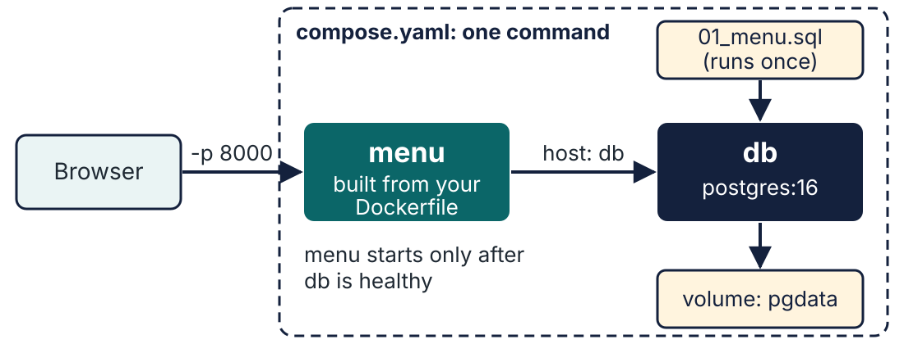

# Lecture 5 · Demo 3: Ship It and Add a Database

**Mastering Computer Science Technical Competencies** · Lecture 5: A Box That Just Runs

---

## The Scenario So Far

The menu runs in a box, and rebuilds take half a second. Tom is happy, but:

> **Tom:** "It needs a database on staging too. And the title has to say
> 'Staging', not 'NovaStack menu'. And I want to pull it from a registry, not
> from your laptop."

Three things left: **a database** next to the app (one command), **settings**
without changing code, and **shipping** the image.

---

## About This Demo

**Time:** about 3 minutes live (Step 6 of the lecture); Steps 7 and 8 are for
you to do yourself. About 25 minutes in total.

| Step | Title | You'll use |
|---|---|---|
| 6 | One Command for the Whole Kitchen | Why Compose, services, networks, volumes, health checks, `compose.yaml`, `docker compose up / ps / exec / down` |
| 7 | Configuration, Not Code | `-e`, `--env-file`, `.env`, why secrets stay out of images |
| 8 | Ship It | `docker tag`, versions, Docker Hub (optional), `arm64` vs `amd64`, `buildx` |

You need Steps 3 to 5 of [Demo 2](Lecture-5-Demo-2-Package-the-Menu.md)
done, so there's a `Dockerfile` in your folder. Missed them? Copy the finished
one:

macOS / Linux:

```bash
cp Dockerfile.step5 Dockerfile
docker build -t novastack-menu:0.5 .
```

Windows (PowerShell):

```powershell
Copy-Item Dockerfile.step5 Dockerfile
docker build -t novastack-menu:0.5 .
```

(Steps 7 and 8 use the image `novastack-menu:0.5` that Demo 2 builds. If you
changed the heading in Demo 2, run `git restore templates/index.html` first.)

### Why this matters

- **App plus database is the standard local set-up.** The Stack Overflow 2026
  survey's tool is named "Docker / Docker Compose": the two are used together.
  Lecture 6 starts from the database you'll start in Step 6, so everyone
  has an identical one whichever laptop they use.
- **Basics, configuration and networking cause most questions.** An analysis of
  113,922 Docker questions on Stack Overflow found these topics dominate
  (Haque et al., ESEM 2020: practitioners, not students).
- **Secrets leak.** A scan of 337,171 container images found **8.5% contained
  valid secrets** such as private keys and API keys (Dahlmanns et al., ASIA
  CCS 2023).
- **Standard set-ups help students.** In a 2023 study of three courses, 84% of
  students adopted a Docker-based environment and 75% of the 42 who answered
  the survey said it contributed to their success (Fernalld et al., SIGITE 2023).

| Icon | Meaning |
|---|---|
| ✅ | **Checkpoint** |
| ❓ | **Check your understanding** (click *Answer*) |
| 💬 | **Discuss** |
| ⚠️ | **Warning** |
| 💡 | **Tip** |

---

## Step 6: One Command for the Whole Kitchen

*Tom's first request: "It needs a database on staging too."*

### Goal 6.1: Why do we need Compose?

Real services rarely run alone. The menu will soon read its items from a
**database** (Lecture 6), and a bigger system might add a cache, a queue or a
second service. Each of those runs in **its own container**: one job per box,
so the official `postgres` image (kept up to date by Postgres's own team) can be
upgraded without touching your app, and the other way round.

You already know enough to start both boxes by hand. It would look like this
(**just read it, don't run it**; macOS/Linux syntax):

```bash
docker network create menu-net
docker volume create pgdata
docker run -d --name db --network menu-net --env-file .env \
  -v pgdata:/var/lib/postgresql/data \
  -v "$(pwd)/db/init:/docker-entrypoint-initdb.d:ro" postgres:16
# ...now wait until the database is ready, then:
docker build -t novastack-menu:0.5 .
docker run -d --name menu --network menu-net -p 8000:8000 \
  -e MENU_TITLE="NovaStack menu" novastack-menu:0.5; echo http://localhost:8000
```

That's five commands, about a dozen settings, an order that matters and a wait
in the middle. Every teammate (and Tom, on staging) has to type exactly the
same thing. One typo, and you're back to *"it works on my machine"*.

**Docker Compose** writes all of that down in **one file**, `compose.yaml`,
which you commit to Git next to the code. Then **one command** starts the whole
set, the same way on every laptop. If a Dockerfile is the **recipe** for one
dish, `compose.yaml` is the **order for the whole table**: which dishes, how
they're served, and which one comes first.



Four ideas you'll meet in the file:

| Idea | What it is |
|---|---|
| **Service** | One container in the set, with a name: here `menu` and `db`. Compose creates and names the containers for you |
| **Network** | Compose puts all the services on a private network of their own. Each one can reach the others **by service name**: the menu would connect to the host `db`, as if looking it up in a phone book |
| **Volume** | Storage that lives **outside** any container. Everything a container writes is normally deleted with the container; a volume keeps it, so the database survives a restart |
| **Health check** | A command Docker runs to ask a service *"are you ready?"*. Started isn't the same as ready: Postgres needs a few seconds before it accepts connections |

❓ **Check your understanding:** why not put the app and the database in **one**
container?

<details><summary>Answer</summary>

Separate boxes can be **upgraded, restarted and scaled separately**, and each
uses an image maintained by the people who know it best (you write the app's
image; the Postgres team writes theirs). One box per job also keeps each image
small and its logs readable. Compose is what makes several boxes as easy as one.
</details>

### Goal 6.2: Read `compose.yaml`

Open `compose.yaml` in VS Code:

```yaml
# The containers that make up the application. Each name below is one service.
services:
  # Service 1: our Flask app.
  menu:
    # Build the image from the Dockerfile in this folder.
    build: .
    # Publish a port, as docker run -p does: host port 8000 -> container port 8000.
    ports:
      - "8000:8000"
    # Environment variables for the container (the same as docker run -e).
    environment:
      MENU_TITLE: "NovaStack menu (Compose)"
    # Start this service only after "db" reports it is healthy (ready for connections).
    depends_on:
      db:
        condition: service_healthy

  # Service 2: the database.
  db:
    # Use the official ready-made Postgres 16 image (nothing to build).
    image: postgres:16
    # Read the database user, password and name from the .env file (never committed).
    env_file: .env
    volumes:
      # A named volume (declared at the bottom): the data survives the container being removed.
      - pgdata:/var/lib/postgresql/data
      # Put the files from db/init where Postgres looks for start-up scripts (:ro = read-only).
      - ./db/init:/docker-entrypoint-initdb.d:ro
    # How Compose asks the database "are you ready?"
    healthcheck:
      # pg_isready succeeds once Postgres accepts connections. $$ stops Compose
      # substituting the variable, so the shell inside the container reads it.
      test: ["CMD-SHELL", "pg_isready -U $${POSTGRES_USER} -d $${POSTGRES_DB}"]
      # Check every 3 seconds, give each check 3 seconds, and give up after 10 failures.
      interval: 3s
      timeout: 3s
      retries: 10

# Declare the named volume used by the db service above.
volumes:
  pgdata:
```

| Part | Means |
|---|---|
| `services:` | The containers that make up the application: here `menu` and `db` |
| `build: .` | Build the `menu` image from the `Dockerfile` in this folder (you wrote it) |
| `ports: "8000:8000"` | Same as `-p 8000:8000` (**host:container**) |
| `environment:` | Same as `-e` |
| `image: postgres:16` | Don't build the database: use the **official** image, version 16 |
| `env_file: .env` | Read the database's settings (user, password, name) from a file |
| `volumes: pgdata:…` | A **named volume**: storage that outlives the container |
| `./db/init:/docker-entrypoint-initdb.d:ro` | Put the files in `db/init` where Postgres looks for start-up scripts (read-only) |
| `healthcheck:` | How to ask the database "are you ready?" |
| `depends_on: … service_healthy` | Don't start `menu` until `db` says it's ready |

There's no line for the **network**: Compose creates one for the project
automatically and puts both services on it. Compare the table with the five
hand-typed commands in Goal 6.1: every setting is still there, just written
down once.

💡 There's no `version:` line at the top: older tutorials have one, but Compose
now ignores it and warns you if it's there. The file is named **`compose.yaml`**.

💡 **Where would Compose be used?** For running a whole system on a laptop, in
demos and in automated tests. Big production systems usually use an
**orchestrator** such as Kubernetes, which starts containers across many
servers; that's for a later course.

### Goal 6.3: Check your `.env`

The database needs a username and password. They're in **`.env`**, the file you
made in [Demo 2, Goal 5.4](Lecture-5-Demo-2-Package-the-Menu.md#goal-54-a-secret-in-the-box)
and that is **never committed**. Skipped that? Make it now:

macOS / Linux:

```bash
cp .env.example .env
```

Windows (PowerShell):

```powershell
Copy-Item .env.example .env
```

Open `.env` and change `POSTGRES_PASSWORD=change-me` to a password of your own.

⚠️ `.env` is listed in `.gitignore` so Git ignores it. Check:
`git status` should **not** list `.env`. If it does, stop and ask. You'll learn why
in Step 7.

### Goal 6.4: Start everything

```bash
docker compose up -d; echo http://localhost:8000
```

- `compose up` = create and start everything in `compose.yaml`.
- `-d` = in the background.
- The first time it **builds** the `menu` image and **pulls** `postgres:16`
  (a large download if you skipped the pre-pull).

✅ **Checkpoint:** the output ends with the database `Healthy`, then the menu
`Started`:

```text
 Container novastack-menu-db-1 Healthy
 Container novastack-menu-menu-1 Starting
 Container novastack-menu-menu-1 Started
```

(The prefix is your folder's name.)

```bash
docker compose ps
```

✅ **Checkpoint:** two services; `db` says `(healthy)` and `menu` has
`0.0.0.0:8000->8000/tcp`. Open **<http://localhost:8000>**.

### Goal 6.5: Ask the database a question

```bash
docker compose exec db psql -U menu -c "SELECT count(*) FROM items;"
```

- `compose exec db` = run a command in the running `db` service.
- `psql -U menu` = Postgres's command-line client, as the user `menu`.
- `-c "…"` = run this one SQL query. This is the only SQL you need today: it
  counts the rows in the `items` table. Lecture 6 teaches the rest.

✅ **Checkpoint:**

```text
 count 
-------
    18
(1 row)
```

The menu is in a database that **you never installed**: Postgres 16 runs
inside its own box. The 18 rows came from `db/init/01_menu.sql`, which Postgres
ran the first time it started.

```bash
docker compose exec db psql -U menu -c "SELECT name, price FROM items WHERE category = 'drink';"
```

✅ **Checkpoint:** four drinks: Cola, Orange juice, Sparkling water and Flat white.

### Goal 6.6: Does the data survive?

```bash
docker compose down
```

- Stops and **removes the containers and the network**. The named volume stays.

```bash
docker volume ls
```

✅ **Checkpoint:** a volume ending in `_pgdata` is still there.

```bash
docker compose up -d; echo http://localhost:8000
```

```bash
docker compose exec db psql -U menu -c "SELECT count(*) FROM items;"
```

✅ **Checkpoint:** still `18`. The data lived in the volume, not in the container.

Now the dangerous one:

```bash
docker compose down -v
```

- `-v` also **deletes the volumes**: the database is gone for good.

⚠️ `down -v` is what you use to start fresh, and also how people lose their
database by mistake.

❓ **Check your understanding:** you delete the `db` container with `docker rm -f`
and start a new one from the same image **without** a volume. Where is your data?

<details><summary>Answer</summary>

**Gone.** Everything a container writes lives in that container's own layer and
disappears with it. Anything that must survive (a database!) goes in a
**volume**. This is why Compose gave the database one.
</details>

### Goal 6.7: How would the app use the database?

It doesn't yet: the menu still reads `menu.json`. (The Advanced lab connects
them.) Remember the **network** idea from Goal 6.1: inside Compose, containers
reach each other **by service name**. The app would connect to the host **`db`**, not
`localhost`, because `localhost` inside the `menu` container means the
`menu` container itself.

⚠️ We pinned **`postgres:16`**. Newer Postgres images (18 and later) keep their
data in a different folder (`/var/lib/postgresql`), so the volume line above
would **not** preserve data on them. Always check the image's documentation
before you change a major version.

---

## Step 7: Configuration, Not Code

*Tom wants the title to say "Staging". Do you rebuild the image for that? No.*

**An idea first: environment variables.** Every program starts with a small set
of named settings from whoever started it, its **environment**: `NAME=value`
pairs such as `HOME=/root` or `PATH=...`. A program can read them, so the same
code can behave differently in different places without being changed. That's
how one image can be "NovaStack menu" on your laptop and "Staging menu" on
Tom's server: you **build once** and **configure when you run**.

### Goal 7.1: Pass a setting at run time

`app.py` reads the title from the environment:

```python
TITLE = os.environ.get("MENU_TITLE", "NovaStack menu")
```

Stop anything on port 8000 (`docker compose down`, or `docker rm -f menu`) and run:

```bash
docker run -d --name menu-staging -e MENU_TITLE="Staging menu" -p 8000:8000 novastack-menu:0.5; echo http://localhost:8000
```

- `-e NAME=value` sets an **environment variable** inside the container.
- The **same image** is now configured differently, with no rebuild.

Open **<http://localhost:8000>** in your browser.

✅ **Checkpoint:** the heading says **Staging menu is open**.

💡 For many settings, put them in a file and use `--env-file my.env`. That's what
`env_file: .env` did for the database.

```bash
docker rm -f menu-staging
```

### Goal 7.2: Why secrets never go in the image

An image is a **file you hand to other people**, and everything in it is
readable. Look at what's baked into an official image:

```bash
docker inspect python:3.12-slim --format "{{.Config.Env}}"
```

- Prints the environment variables written into the image (such as
  `PYTHON_VERSION`).

```bash
docker history --no-trunc python:3.12-slim
```

- Prints every instruction used to build it, **in full**.

💬 **Discuss:** if the Dockerfile said `ENV API_KEY=abc123`, who could read it?
(Anyone who has the image, with the two commands above. Deleting the line in a
later layer doesn't help: the older layer is still in the image.)

> **The rule:** settings go in at **run time** (`-e`, `--env-file`, Compose's
> `env_file`), never in the Dockerfile. `.env` files are **git-ignored** and in
> `.dockerignore`, with only a `.env.example` committed.

⚠️ **And never paste a `.env` file or a registry token into an AI chat.**

---

## Step 8: Ship It

### Goal 8.1: Tag a version

```bash
docker tag novastack-menu:0.5 novastack-menu:1.0-ready
```

- `docker tag` gives an existing image **another name**. It doesn't copy it.

```bash
docker images novastack-menu
```

✅ **Checkpoint:** `1.0-ready` and `0.5` show the **same image ID**.

❓ **Check your understanding:** why does Tom prefer `novastack-menu:1.0-ready` to
`novastack-menu:latest`?

<details><summary>Answer</summary>

`latest` is just a **name**. It means "whatever was tagged last", not "the
newest" or "the best". If staging breaks, you can't tell which version it's
running or go back to the one before. A version tag (`1.0-ready`, then `1.1`) says
exactly what's deployed and lets you **roll back**: the same idea as SFIA's
"rolling back deployments".
</details>

### Goal 8.2 (optional): Push to Docker Hub

**An idea first: registries.** A **registry** is an online library of images.
Docker Hub is the biggest (it's where `python`, `nginx` and `postgres` came
from); GitHub, the cloud providers and many companies run their own. `docker
push` uploads an image to a registry and `docker pull` downloads one, so a
server can run exactly the image you built, without your laptop.

You need a free Docker Hub account and `docker login` ([Demo 0](Lecture-5-Demo-0-Setup.md#step-5-a-free-docker-hub-account-optional)).
Replace `<your-username>` with your Docker Hub username.

```bash
docker tag novastack-menu:1.0-ready <your-username>/novastack-menu:1.0-ready
```

- On Docker Hub, an image's name starts with **your username**.

```bash
docker push <your-username>/novastack-menu:1.0-ready
```

- Uploads it. (A free Personal account includes unlimited **public** repositories.)

Anyone, on any laptop with Docker, can now download and run your service. First
**pull** it (download it from Docker Hub):

```bash
docker pull <your-username>/novastack-menu:1.0-ready
```

- Downloads the image from the registry, the way `docker pull nginx` did in
  [Demo 0](Lecture-5-Demo-0-Setup.md#step-4-pre-download-the-images-optional-recommended). To prove it really comes from Docker Hub, remove your local copy first
  with `docker rmi <your-username>/novastack-menu:1.0-ready` and pull again.

Then run it:

```bash
docker run -d -p 8000:8000 -e IMAGE_NAME=<your-username>/novastack-menu:1.0-ready <your-username>/novastack-menu:1.0-ready; echo http://localhost:8000
```

- `-e IMAGE_NAME=…` tells the app which image it is running from (a container
  can't see that itself), so the page says **Running on Linux via Docker ·
  <your-username>/novastack-menu:1.0-ready**.
- The `echo` after the `;` prints a link under the container ID to click.

✅ **Checkpoint:** a classmate (or you, after `docker rmi`) runs that command and
gets the page, with nothing else installed. **That's what Tom wanted.**

⚠️ Everything in a **public** image is public. Never push an image that contains
a `.env` file or other secrets. This is why the `.dockerignore` matters.

### Goal 8.3: Apple Silicon and the "exec format error"

```bash
docker image inspect novastack-menu:1.0-ready --format "{{.Os}}/{{.Architecture}}"
```

(Windows PowerShell: the same command, as written.)

✅ **Checkpoint:** `linux/arm64` on a Mac with an M-series chip, `linux/amd64`
on most Windows and Linux laptops.

💬 **Discuss:** most cloud servers and CI runners are `amd64`. What happens if
you build on an M-series Mac and push the image to one of them? (It fails with
`exec format error`: the program was built for a different kind of processor.
Official images such as `python` and `postgres` are published for **both**, so
they just work.)

Build for **both** processors at once:

```bash
docker buildx build --platform linux/amd64,linux/arm64 -t novastack-menu:multi .
```

- `buildx` is Docker's extended builder. `--platform` lists the processors.
- With Docker Desktop it builds the other kind with emulation (slower). To
  share it, add `--push` and use `<your-username>/novastack-menu:1.0-ready` as the tag.

Check that each version runs:

```bash
docker run --rm --platform linux/amd64 novastack-menu:multi python -c "import platform; print(platform.machine())"
```

```bash
docker run --rm --platform linux/arm64 novastack-menu:multi python -c "import platform; print(platform.machine())"
```

✅ **Checkpoint:** `x86_64` for the first and `aarch64` for the second (an
Apple-silicon Mac runs `amd64` using emulation; an Intel laptop does the reverse).

💡 Once an image is **pushed** to a registry, `docker buildx imagetools inspect <your-username>/novastack-menu:1.0-ready`
lists every platform in it. It doesn't work on an image that's only on your laptop.

💡 This works out of the box on Docker 29 or newer, where the "containerd image
store" is the default. On an older Docker Desktop, switch it on first
(**Settings → General → Use containerd for pulling and storing images**).

### Goal 8.4: Docker's own helpers

- **`docker init`** asks a few questions and **generates** a `Dockerfile`, a
  `.dockerignore` and a `compose.yaml` for your language (Python is supported).
  It isn't AI: it's templates written by Docker's experts. Try it in an empty
  copy of the project and **compare it with your Dockerfile**.
- **Docker Desktop's own AI assistant** is called Gordon (it needs a recent
  Docker Desktop and a signed-in account). Treat it as you'd treat Copilot: a
  lead, not an oracle. Check what it suggests by building and running it.

### Goal 8.5: Clean up

```bash
docker compose down -v
```

```bash
docker ps -a
```

```bash
docker system df
```

- Remove what you don't need with `docker rm` and `docker rmi`. (`docker system
  prune` is the broad one: read what it lists first.)

---

## Try It Yourself

1. Change `MENU_TITLE` in `compose.yaml` to `"Tea Time"` and run
   `docker compose up -d` again. Does it rebuild the image? Does the page change?
2. Start the stack, then run `docker compose logs menu` and
   `docker compose logs db`. Which log tells you the database is ready?
3. Run `docker compose down -v`, then `docker compose up -d`, and count the rows
   again. Why is it `18` and not `36`?
4. Change `POSTGRES_PASSWORD` in `.env` **after** the database exists, and
   restart (`docker compose down`, then `up -d`). Does the new password work? (Try
   `docker compose exec db psql -U menu -c "SELECT 1;"`.) What does that tell you?

<details><summary>Answers</summary>

1. It doesn't rebuild (nothing in the image changed), but it **re-creates** the
   `menu` container with the new setting, so the page title changes. Settings
   are not code.
2. The `db` log: `database system is ready to accept connections`.
3. The start-up script runs only when the volume is **empty**. After `down -v`
   it's empty, so the script runs once and loads the 18 rows. It never doubles up.
4. `docker compose exec` talks to the database from inside, and it still works,
   because the password was set when the database was **first created** and the
   volume remembers it. To change it you'd alter the password in the database, or
   start again with `down -v` (which deletes the data). A good example of
   "configuration vs state".
</details>

---

## Next

The Lecture 5 **labs**: *Ship the Menu* (Beginner), *Make It Production-Shaped*
(Intermediate) and *App + Database with Compose* (Advanced). Lecture 6 starts
with the database you started in Step 6.
