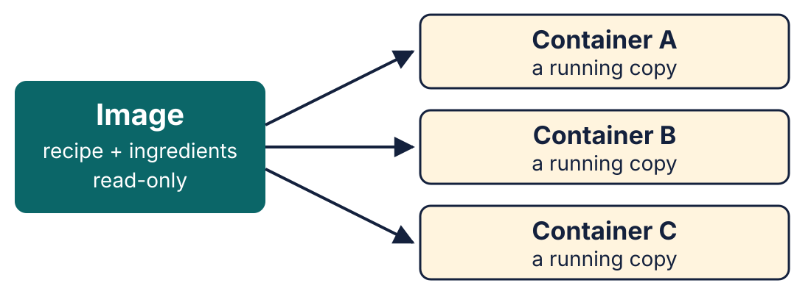
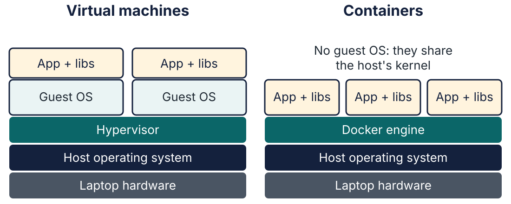
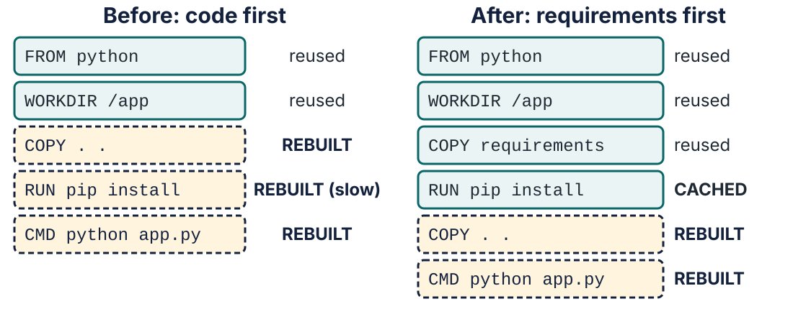
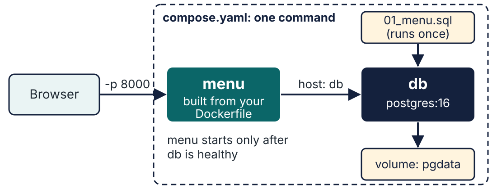

<!-- _class: lead -->
<!-- _paginate: false -->

# A Box That Just Runs

## Lecture 5 · Docker and containers

**Images · containers · Dockerfiles · Compose · an AI that drafts, and Docker that judges**

<span class="small">Slides, demos, exercise and labs: `lectures/05-docker/`</span>

<!--
Welcome. Last two weeks: your laptop as a professional workstation (Lectures 3 and 4). Today: how to ship what you built, in a box that runs the same everywhere.
Accessibility: these slides are also on Moodle/GitHub as HTML (screen-reader friendly, zoomable) and PDF.
-->

---

# Today

| Time | What | Where to find it |
|---|---|---|
| 6 min | Tom's request, why Docker, images and containers | |
| 22 min | **Steps 1 to 6**: run, build and ship a box | Demo guides 1 to 3 |
| 7 min | **Three Mentimeter questions** during the demos | menti.com |
| 7 min | Habits, gotchas and the labs | |
| 8 min | **Attendance form** and **anonymous feedback** | QR codes at the end |

Everything I type is written up step by step in the demo guides. Follow along, or just watch.

<!--
35 minutes of teaching (6 + 22 + 7), 7 minutes of Mentimeter and 8 minutes of forms: 50 in all. The exercise is Part 0 of each lab, not in the lecture.
-->

---

# Monday, 9:00: a message from Tom

> **Tom** (platform): "Your menu page works great on your laptop. Staging has **Python 3.9**, **no uv**, and I'm not allowed to change it. I'm not installing your laptop on my server."
>
> "Can you give me **a box that just runs**?"

**Jordan:** "Same lesson as the 3 AM Page: something was *different over there*. Pack the environment **with** the code."

<!--
Link back to Lecture 1: the incident was "different over there". Lecture 3 gave you a good laptop; today the code leaves it. The service is tiny on purpose: one file, one dependency (Flask).
-->

---

# By the end of today you can…

1. Explain **image**, **container** and how a container differs from a **virtual machine**
2. **Run, inspect, stop and clean up** containers (`run`, `ps`, `logs`, `exec`, `stop`, `rm`)
3. Read, and write, a **Dockerfile** for a Python service
4. Use a **log** to find out why a container won't start
5. Start an app **and its database** with one **Compose** command
6. Use an **AI** to draft, explain and review a Dockerfile, and **prove** each answer with Docker

---

# Why bother? The evidence

| Source | Finding |
|---|---|
| Stack Overflow Developer Survey, 2025 | Docker used by **73.8%** of professional developers and **52.5%** of people learning to code |
| ITJobsWatch, UK permanent ads, 6 months to 3 Nov 2026 | **2,046** ads mention Docker; median salary **£67,500** |
| SFIA *Deployment*, entry level (Level 2) | "Executes defined deployment processes and procedures using deployment tools and techniques." |

The gap between those two survey numbers is what today closes.

<!--
Caveats to say out loud if asked: Stack Overflow says part of the 2025 jump is because it merged some technology categories that year, so don't read it as pure growth. Most job ads list Docker as "desirable": familiarity is enough for a first job. Don't quote the 2026 survey figure (59.1%): a different question base. SFIA text checked on sfia-online.org.
-->

---

# An image is the recipe, a container is the meal



An **image** is stored once and never changes. Each **container** is a running copy cooked from it.

<!--
Analogy: recipe and ingredients, and a meal being cooked. You can cook many meals from one recipe; eating one doesn't change the recipe. Students most often confuse the two: "I edited the container, why didn't the image change?"
Do NOT say what happens to files here: that is Mentimeter question 1.
-->

---

# Containers are not virtual machines



A VM brings **a whole kitchen**; a container shares yours. That's why it starts in a second.

<!--
Docker Desktop on Mac and Windows quietly runs one small Linux VM underneath, because containers are Linux programs. CS2023 expects students to compare containers and VMs and weigh the trade-offs: weaker isolation than a VM, much lighter.
-->

---

<!-- _class: demo -->

# Step 1: run someone else's software

```bash
docker version
docker run --rm hello-world
docker run --rm python:3.12-slim python -V
```

- `run` = create a container from an **image** and start it
- `--rm` = delete the container when it stops
- `python:3.12-slim` = the image **name:tag**; `python -V` = the command to run **inside**

**Nothing was installed on this laptop for that.**

<!--
Demo 1, Step 1. First run downloads the image ("Unable to find image locally"); second is instant: one download, many containers. Pre-pull python:3.12-slim, nginx and postgres:16 before the lecture (Docker Hub limits: 100 pulls per 6 hours per address without an account).
-->

---

<!-- _class: menti -->

# Mentimeter question 1 of 3
<div class="menti-grid">
<div>


**Predict:** you start **three containers from the same image**. One of them creates a new file. What do the **other two** containers see?

1. The new file, because they share one image
2. Nothing: each container has its own private changes
3. The new file, but only after a restart
4. It depends on how much memory they have

</div>
<div>


<p class="join"><strong>menti.com</strong><br>code <strong>2590 7185</strong></p>

</div>
</div>


<!--
Join code 2590 7185 and QR added 10 Nov 2026 (code expires 12 Nov; re-copy from Participant sharing if reused). A prediction: they have not seen this yet. 60 seconds to vote, then the answer on the next slide.
-->

---

# Question 1: the answer is 2, nothing

| Option | Why |
|---|---|
| The new file, they share one image | The image is **read-only**: nobody can change it from a container |
| **2. Nothing (correct)** | **Each container writes to its own private layer**, which disappears with it |
| The new file, after a restart | Restarting doesn't merge containers |
| Depends on memory | Memory doesn't change what a container can see |

> Anything that must survive a container (a database!) goes in a **volume**. We'll see one in Step 6.

---

<!-- _class: demo -->

# Step 2: start a web server

```bash
docker run -d --name web -p 8080:80 nginx; echo http://localhost:8080
docker ps
docker logs web
docker exec -it web sh
```

Open **localhost:8080**, reload, run `docker logs web` again.

- `-d` background · `--name web` a name you choose
- `-p 8080:80` = **my door 8080 → the box's door 80** (always **host:container**)
- `exec -it … sh` = a shell **inside** the running container; `exit` to leave

<!--
Demo 1, Step 2. Windows: use PowerShell, not Git Bash (-it fails there). The log line "GET / ... 200" is the Lecture 1 log-reading skill again.
-->

---

# The six commands you will use every day

| Command | Means |
|---|---|
| `docker run` | Create a container from an image and start it |
| `docker ps` | What's running? (`-a`: including stopped) |
| **`docker logs`** | What has it printed? **Look here first.** |
| `docker exec` | Run a command inside it |
| `docker stop` | Stop it |
| `docker rm` | Delete it |

```bash
docker stop web
docker rm web
```

<!--
Cleaning up: docker rmi removes images, docker system df shows disk use. Do NOT run docker system prune on the demo laptop (it has other containers). Use docker ps -a --filter name=menu if the list is cluttered.
-->

---

<!-- _class: act -->

# Act 2
## "Build your own box"
Steps 3 to 5: a Dockerfile, an AI that drafts it, and a crash

<!--
Tom's message again: "Can you give me a box that just runs?" The service: app.py (Flask: three routes and a small HTML template) and requirements.txt (one line: flask). Optional, 20 s: `uv run app.py`, open localhost:8000 ("Running on Darwin · machine <your laptop>"), Ctrl+C. "It works on my machine: Flask is in this folder's .venv." Stop it before Step 3: it holds port 8000.
-->

---

# Step 3: ask an AI for a Dockerfile

In Copilot Chat (**Ask** mode), attach `app.py` and `requirements.txt`, then:

```text
Write a Dockerfile for this Flask app. Use Python 3.12.
It listens on port 8000.
Add a comment above every instruction explaining
what it does, so students can understand every command.
```

**Read it. Can you explain every line?** Check each comment is right; add a `# why:` where it only says *what*. A line you can't explain gets looked up, or removed.

<!--
Role 1 of 3: the AI as author. AI answers vary: often it just works. Run it live. If it's right, say so ("it got it right this time, which is the usual case"), build it, then say "here's one I saved earlier" and show the next slide. Never pretend the live AI made the mistake.
-->

---

# One I saved earlier: a Dockerfile is a list of steps

```dockerfile
FROM python:3.12-slim
WORKDIR /app
COPY . .
CMD ["python", "app.py"]
```

| Line | Means |
|---|---|
| `FROM` | Start from the official slim Python 3.12 image |
| `WORKDIR` | Work in `/app` inside the box |
| `COPY . .` | Copy my files in |
| `CMD` | When the container starts, run this |

<!--
This is a PLANTED mistake, the kind a beginner or a rushed draft makes. Modern assistants usually get this right (3 of 3 stand-in trials with a different model did), so say so honestly: "I saved this one earlier." Ask: what's missing? Don't answer yet.
-->

---

<!-- _class: demo -->

# Step 3: build it, run it… and it stops

```bash
docker build -t novastack-menu:0.1 .
docker run -d --name menu -p 8000:8000 novastack-menu:0.1
docker ps
docker ps -a
docker logs menu
```

```text
menu   Exited (1) 2 seconds ago

ModuleNotFoundError: No module named 'flask'
```

**Paused here.** It worked on my laptop. Why not in the box?

<!--
Demo 2, Step 3. The guide adds "; echo http://localhost:8000" after docker run -d (a clickable link); left off the slide to keep the text large. docker ps shows nothing; ps -a shows Exited (1); the log is a 4-line traceback ending in the one line above. Leave the log on screen for Mentimeter question 2: "while still paused".
-->

---

<!-- _class: menti -->

# Mentimeter question 2 of 3
<div class="menti-grid">
<div>


The code ran fine on my laptop, but the container **stops within a second**. What is the **most likely cause**?

1. Docker is broken on this laptop
2. Something the code needs was on my laptop but was never put in the box
3. The code needs a faster computer
4. The website address is wrong

</div>
<div>


<p class="join"><strong>menti.com</strong><br>code <strong>2590 7185</strong></p>

</div>
</div>


<!--
Ask while the traceback is still on screen. 60 seconds to vote.
-->

---

# Question 2: the answer is 2, the box started empty

- Flask is installed on **my laptop**, not in the box
- A container has **only what the image gives it**, plus what you `COPY` in
- "It works on my machine" means *my machine has something yours doesn't*
- A **Dockerfile** is where you write that something down

> That one line of the log told us exactly what to do. **Look at the log first.**

---

# Step 4: read the log, then ask the AI to read it

**1. Predict first:** "I think the problem is ___."

**2. Give the AI evidence:** attach the Dockerfile **and paste the log**. Attaching a file doesn't send your terminal.

```text
This container exits straight away. Here are the Dockerfile and
the log. What is wrong, and what is the smallest change that fixes it?
Log: <paste the lines from docker logs menu>
```

**3. Compare** its answer with your prediction. Does it quote the error from the log?

<!--
Role 2 of 3: the AI as reader. Say your own diagnosis first, then compare. PASTE the log text into the prompt: attaching the Dockerfile doesn't send the terminal, and in a trial Copilot answered "I don't see the log" and guessed (correctly, but it was a guess). Check its answer quotes ModuleNotFoundError.
-->

---

<!-- _class: demo -->

# Step 4: fix the box and prove it

Add one line after `COPY . .`:

```dockerfile
RUN pip install -r requirements.txt
```

```bash
docker rm menu
docker build -t novastack-menu:0.2 .
docker run -d --name menu -p 8000:8000 novastack-menu:0.2
curl localhost:8000/menu
```

Open **localhost:8000**: the same page, now **Running on Linux via Docker**.

- `RUN` happens when you **build** the image; `CMD` when you **run** a container

<!--
Demo 2, Goals 4.3-4.4. Short of time: cp Dockerfile.step4 Dockerfile instead of typing the line. docker rm menu first: the stopped container still owns the name. The demo guide adds "; echo http://localhost:8000" after docker run -d to print a clickable link; it is left off the slide to keep the text large. Windows: curl.exe. The page says "Running on Linux via Docker · container <container ID>" (compare docker ps). Same code, different box. To Tom: "Try it on staging": it brings its own Python 3.12 and Flask.
-->

---

# Three habits for working with an AI

| Role | Prompt | How we proved it |
|---|---|---|
| **Author** | "Write a Dockerfile for this app" | We built it and ran it |
| **Reader** | "Here are the file and the log. What is wrong?" | The page loaded |
| **Reviewer** | "Review this. At most three problems" | We timed the rebuild (next) |

1. Give it **evidence**, not a guess
2. Ask for a **short list**
3. **Prove it** with a command. Docker is the judge.

<!--
Same rule as Lectures 3 and 4: AI is a lead, not an oracle. Docker is a good place to practise it because checking takes seconds.
-->

---

# Step 5: now make it quick



Every instruction is a **layer**. Docker reuses a layer only if it **and everything above it** are unchanged.

<!--
Demo 2, Step 5. Change the heading line in templates/index.html ("is open" -> "is open today"): with the Step 4 Dockerfile Flask is downloaded again (about 3 s here, longer on slow Wi-Fi). Rule: what changes least goes first.
-->

---

<!-- _class: demo -->

# Step 5: the AI reviews, we prove one change

```text
Review this Dockerfile. Give me at most three problems,
most important first.
```

Typical answers: requirements first · `.dockerignore` · not root · pin the image. We apply the **caching** one: install **before** copying the code.

```bash
docker build -t novastack-menu:0.4 .
# edit the heading in templates/index.html, then:
docker build -t novastack-menu:0.5 .
```

**About 3 s** with the code copied first (Flask reinstalled) → **about 0.6 s** now (`CACHED`).

<!--
Role 3 of 3: the AI as reviewer. Short of time: don't wait for Copilot, read the typical answers from the slide, and cp Dockerfile.step5 Dockerfile instead of editing by hand. The order of its answers varies: in a trial Copilot ranked .dockerignore first and requirements-first third. We apply the caching one (it fixes the slow rebuild) and never apply what we can't explain. Its .dockerignore point comes back on the "secret in the box" slide. Timings: 3.3 s and 0.5 s on 3 Nov 2026, 2.9 s and 0.6 s on 10 Nov 2026 (lecturer's MacBook, warm cache). Use plain docker build (not -q) so the CACHED lines show. Type a heading you have NOT used in rehearsal, or the "slow" build is CACHED too.
-->

---

<!-- _class: menti -->

# Mentimeter question 3 of 3
<div class="menti-grid">
<div>


**Predict:** you delete a container that ran a **database**, then start a new one from the **same image**. Where is your data?

1. Still there: it was saved in the image
2. Gone, unless it was kept in a volume
3. Still there, once the new container has restarted
4. In the other containers made from that image

</div>
<div>


<p class="join"><strong>menti.com</strong><br>code <strong>2590 7185</strong></p>

</div>
</div>


<!--
60 seconds to vote. It recalls Question 1 (a container's changes are private and disappear with it) and sets up Step 6, where the database gets a volume. Changed on 10 Nov 2026 from "An AI gives you a Dockerfile you half understand: what first?" (its right answer was too easy to spot; the three habits slide makes that point).
-->

---

# Question 3: the answer is 2, gone without a volume

| Option | Why |
|---|---|
| Still there, saved in the image | An image is **read-only**: a running container never writes to it |
| **2. Gone, unless in a volume (correct)** | **A container's own files are deleted with the container** |
| Still there after a restart | A new container starts from the image again |
| In the other containers | Each container's changes are private (Question 1) |

> A **volume** is storage outside any container. Step 6 gives the database one.

---

<!-- _class: demo -->

# Step 5, one more thing: a secret in the box

```bash
cp .env.example .env          # passwords for Step 6; Git ignores it
docker build -t novastack-menu:0.6 .
docker run --rm novastack-menu:0.6 cat .env
```

```text
POSTGRES_USER=menu
POSTGRES_PASSWORD=change-me     # ...and two more lines
```

Git ignored `.env`. **Docker didn't**: `COPY . .` copied it. Add a **`.dockerignore`** (like `.gitignore`, for builds), rebuild as `0.7`, and `cat .env` says *No such file*.

<!--
Demo 2, Goals 5.4-5.5. This is the reviewer's .dockerignore point made visible. Anyone you hand the image to can read it with one command: 8.5% of 337,171 public images held valid secrets (Dahlmanns et al., 2023). Windows: Copy-Item .env.example .env. Then: cp extras/dockerignore.example .dockerignore; docker build -t novastack-menu:0.7 .; docker run --rm novastack-menu:0.7 cat .env -> "No such file or directory". Have the commands ready to paste. If short of time, show this slide and say it.
-->

---

<!-- _class: act -->

# Act 3
## "The whole kitchen"
Step 6: the menu **and** a database, in one command

---

# Step 6: why Compose? Two boxes by hand

```bash
docker network create menu-net
docker volume create pgdata
docker run -d --name db --network menu-net --env-file .env \
  -v pgdata:/var/lib/postgresql/data postgres:16   # + the start-up script
# ...wait until the database is ready...
docker build -t novastack-menu:0.5 .
docker run -d --name menu --network menu-net -p 8000:8000 \
  novastack-menu:0.5                      # + its settings
```

Five commands, a dozen settings, an order and a wait, typed the same by **everyone**. One typo: *"it works on my machine"* again.

**Compose** writes it all down in **one file**, `compose.yaml`, committed with the code. Then **one command** starts the lot.

<!--
Demo 3, Goal 6.1. Don't run these: they're the "before". Each job gets its own box (the Postgres team maintains its image; you maintain yours), so you can upgrade either one alone. Compose = the order for the whole table; a Dockerfile = the recipe for one dish. Used for laptops, demos and tests; big production systems use an orchestrator such as Kubernetes (a later course).
-->

---

# Step 6: one command, two containers



**Services** (`menu`, `db`) on a private **network**, found **by name**; a **volume** keeps the data; a **health check** says when `db` is ready.

---

<!-- _class: demo -->

# Step 6: start the whole stack

```bash
docker compose up -d
docker compose ps
docker compose exec db psql -U menu -c "SELECT count(*) FROM items;"
docker compose down
```

```text
 count
-------
    18
```

- Postgres 16 ran **without being installed**; the 18 rows came from `01_menu.sql`
- Containers find each other **by service name** (`db`), not `localhost`
- `down` keeps the data; `down -v` deletes it

<!--
Demo 3, Step 6. Pre-pull postgres:16. The guide adds "; echo http://localhost:8000" for a clickable link. Compose reads .env (never committed), made in Step 5 (make it before the lecture too, in case Step 5 was cut). Pinned to 16 on purpose: Postgres 18+ moves the volume path. The app doesn't read the database yet: the Advanced lab connects them, and Lecture 6 (SQL) starts from this database. Windows: Copy-Item .env.example .env.
-->

---

# Habits that save you later

| Habit | Why |
|---|---|
| **No secrets in images** (`.env` out of Git and out of the image) | A scan of **337,171** images found **8.5%** held valid secrets, such as private keys (Dahlmanns et al., 2023) |
| **Pin versions** (`python:3.12-slim`, `flask==3.1.3`), tag releases, avoid `latest` | **34%** of a sample of 560 GitHub projects' Dockerfiles failed to build (Cito et al., 2017) |
| **Don't run as root** (`USER`) | Less power if the app is ever broken into |
| **`.dockerignore`** | Keeps `.git` and `.env` out, and builds faster |

<!--
Settings go in at run time (-e, --env-file, Compose env_file), never in the Dockerfile: anything in an image can be read with docker history. Never paste a .env file or a registry token into an AI chat.
-->

---

# Gotchas to know before the labs

- **Mac: port 5000 is taken** by AirPlay Receiver. Use 8000, 8001 or 8080
- **Apple Silicon builds `arm64` images**; most cloud servers are `amd64`. An unlucky push gives `exec format error` (Demo 3, Step 8)
- **Docker Hub limits downloads** per address: run `docker login`, and pre-pull
- **Windows:** use **PowerShell**, not Git Bash, for `docker exec -it`
- **Disk full?** `docker system df`, then clean up what you don't need

<!--
Each of these has cost someone an hour. They are all in the demo guides' troubleshooting table.
-->

---

# Epilogue: it runs on staging

> **Tom:** "It runs on staging. Python 3.9 and no uv, and I didn't have to touch a thing. 📦"
>
> **Jordan:** "Good. Now: how do we make sure **nobody breaks it again**? Every change, tested and checked, before it ships. That's the next chapter."

<!--
Hook for CI/CD later (Dan's question from the end of Lecture 4, still open).
-->

---

# Before the labs

- **Exercise ORD-371** is Part 0 of every lab: finish a Dockerfile, then fix a page that won't load. It meets the `127.0.0.1` bug
- **Beginner:** *Ship the Menu* · **Intermediate:** *Make It Production-Shaped* · **Advanced:** *App and database with Compose*
- Every step is written up in `lectures/05-docker/demo/`
- Run `docker login` and stop containers you don't need (`docker ps -a`)
- Lecture 6 (SQL) starts from the **database you started in Step 6**

---

# Two short forms, please (about 8 minutes)

<div class="cols">
<div>

**1. Attendance and survey**
University sign-in · about 5 minutes


</div>
<div>

**2. Anonymous feedback**
No names recorded · about 2 minutes


</div>
</div>

Can't scan? Both links are on Moodle. Taking part in the research is **voluntary** and doesn't affect your place on the programme. Every question has an **N/A** option.

<!--
Forms built 10 Nov 2026 and QR codes added. Post both links on Moodle. Attendance form is open only 17:30 to 18:15 on 10 Nov.
-->

---

<!-- _class: lead -->
<!-- _paginate: false -->

# Thank you

## Questions?

<span class="small">Remember: "it works on my machine" is a sentence that ends with "…because of something I forgot to write down."</span>

---

# Appendix: not today, but you will meet them

| Name | One line |
|---|---|
| **Kubernetes** | Runs many containers across many machines. Often listed with Docker in job ads |
| **Docker Swarm** | Docker's older built-in clustering: almost never asked for |
| **Podman** | A Docker-compatible alternative, a free choice if your machine forbids Docker Desktop |
| **Hardened images, signing, SBOMs** | Supply-chain security: later in the programme |

> At graduate level, employers expect you to **run and build** a container, not to design a cluster.

<!--
Appendix: not shown in the 50 minutes unless someone asks about Kubernetes or Podman.
-->
