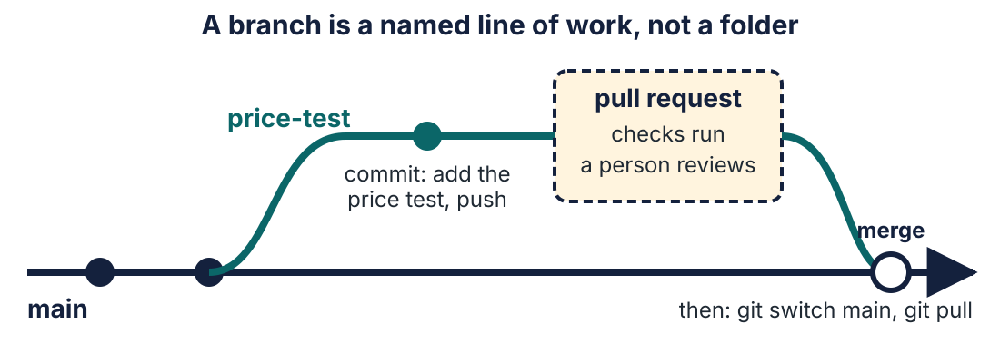

# Lecture 6 · Demo 1: Tests and the Loop

**Mastering Computer Science Technical Competencies** · Lecture 6: Nobody Breaks It Again

---

## The Scenario

Tuesday, 08:40. A message from Dan Hughes, NovaStack's QA engineer:

> **From:** Dan
> **Subject:** Who checked this? 🔍
>
> At 08:31 Mei added the autumn special to the menu and pushed it straight to
> `main`. Tom rebuilt the box. Staging now shows a price the till can't read:
> **£4.5O**, with a letter O. Morgan Lee has just tried to order one.
>
> Nobody ran the tests, and no test looked at prices anyway.
>
> I asked this three weeks ago: **how do we make sure nobody breaks it again?**
>
> – Dan

Jordan adds: *"Tom has put the old menu back. From today, nothing reaches `main`
without a test, a second pair of eyes and a green tick. Build me the gate."*

Mei did nothing unusual: she changed a file and pushed it, which is what the
process allowed. The gate starts with two things: **tests** that know what
"right" looks like, and a **loop** that every change goes round before it
reaches `main`. This demo builds both, by hand. Demo 2 hands the checking to a
robot.

---

## About This Demo

**Time:** about 6 minutes live (Steps 1 and 2 of the lecture); about 40 minutes
if you repeat it yourself.

| Step | Title | You'll use |
|---|---|---|
| 1 | Dan's Promises | `uv run pytest`, `-v`, running one test, reading a failure, `git restore` |
| 2 | The Loop | `git switch -c`, `git status`, `git diff`, `git add`, `git commit`, `git push`, a pull request, a merge, `git pull` |

You'll need your fork of `novastack-menu`, up to date, with the tests passing
([Demo 0](Lecture-6-Demo-0-Setup.md)).

### Why this matters

- **It's what a first task looks like.** When Begel and Simon (2008) followed
  new graduates at Microsoft, a typical first task was a bug fix, and its steps
  included writing a **regression test**, getting the change **reviewed** and
  checking it in. Most of those graduates struggled at some point with the
  version control system.
- **The team you join will have tests.** In the Stack Overflow Developer Survey
  **2023**, **60.79%** of professional developers said their company has
  automated testing. In the **2022** survey, the last that asked, **96.65%** of
  professional developers used **Git**.
- **Branches confuse everyone at first.** A study of students learning Git
  (Isomöttönen and Cochez, 2014) found that many pictured a branch as a
  **folder**. It isn't, and Step 2 shows why, with a diagram.

| Icon | Meaning |
|---|---|
| ✅ | **Checkpoint** |
| ❓ | **Check your understanding** (click *Answer*) |
| 💬 | **Discuss** |
| ⚠️ | **Warning** |
| 💡 | **Tip** |

Commands are written for macOS and Linux; **PowerShell** equivalents are given
where they differ. On Windows, use **PowerShell**, not Git Bash. Shortcuts are
written **Windows/Linux · macOS**.

---

## Step 1: Dan's Promises

*A test is a promise a machine can check.*

**The idea first.** "The menu works" is a hope. "Asking for `/health` returns
`{"status": "ok"}`" is a **promise**: precise enough that a program can check it,
in a fraction of a second, every time anything changes. A **test** is a small
function that checks one promise. It does something to the code and then
**asserts** what should be true. Python's `assert` does nothing if the
statement is true and stops with an `AssertionError` if it's false. A test that
reaches its end **passes**; a test stopped by an error **fails**.

**pytest** is the tool that finds and runs tests. It looks in the `tests`
folder (the project's `pyproject.toml` tells it to), opens every file whose name
starts with `test_`, and runs every function whose name starts with `test_`.

### Goal 1.1: Read Dan's promises

Open **`tests/test_menu.py`** in VS Code (**Ctrl+P · Cmd+P**, then type
`test_menu`). It's short:

```python
"""Dan's promises about the menu. Run them with:  uv run pytest"""

import pytest

from app import MENU, app


@pytest.fixture
def client():
    # Flask's built-in test client: asks the app for pages without a server.
    return app.test_client()


def test_home_page_loads(client):
    assert client.get("/").status_code == 200


def test_health_says_ok(client):
    assert client.get("/health").get_json() == {"status": "ok"}


def test_menu_is_json_for_scripts(client):
    assert len(client.get("/menu").get_json()) == len(MENU)


def test_every_item_has_the_five_fields():
    fields = {"sku", "name", "category", "price", "icon"}
    for item in MENU:
        assert set(item) == fields, item


def test_skus_are_unique():
    skus = [item["sku"] for item in MENU]
    assert len(skus) == len(set(skus))
```

- `from app import MENU, app` loads the real service from `app.py`: `MENU` is the
  list read from `menu.json`, and `app` is the Flask web app.
- `@pytest.fixture` marks `client` as a **fixture**: something a test needs,
  made fresh for each test. A test asks for it by having a parameter with the
  same name (`def test_home_page_loads(client)`).
- `app.test_client()` asks the app for pages **without starting a server**: no
  port, no browser, no network. That's why the tests take a fraction of a second.

In plain words, the five promises are:

| Test | The promise |
|---|---|
| `test_home_page_loads` | The home page answers with status `200` (OK) |
| `test_health_says_ok` | `/health` says `{"status": "ok"}`, which Tom's monitoring checks |
| `test_menu_is_json_for_scripts` | `/menu` gives scripts JSON, with every item on the menu |
| `test_every_item_has_the_five_fields` | Every menu item has exactly `sku`, `name`, `category`, `price` and `icon` |
| `test_skus_are_unique` | No two items share a stock code (`sku`) |

### Goal 1.2: Run them

In VS Code's terminal (**Ctrl+\` · Ctrl+\`**), in the `novastack-menu` folder:

```bash
uv run pytest
```

- `uv run` runs a command with the project's Python in `.venv`.
- `pytest` finds and runs every test in `tests/`.

Pip route (if you set up with pip in Demo 0), macOS and Linux:

```bash
.venv/bin/python -m pytest
```

- Runs pytest with the Python inside `.venv`.

PowerShell:

```powershell
.venv\Scripts\python -m pytest
```

- The same, with the Windows path to `.venv`'s Python.

✅ **Checkpoint:** you see something like this (the versions, folder and time
will differ):

```text
============================= test session starts ==============================
platform darwin -- Python 3.12.7, pytest-9.2.0, pluggy-1.7.0
rootdir: /Users/you/novastack-menu
configfile: pyproject.toml
testpaths: tests
collected 5 items

tests/test_menu.py .....                                                 [100%]

============================== 5 passed in 0.22s ===============================
```

How to read it, top to bottom:

- `platform ... Python 3.12.7, pytest-9.2.0` says which Python and pytest ran.
  When a test passes on one laptop and fails on another, compare these first.
- `configfile: pyproject.toml` and `testpaths: tests` say where pytest got its
  settings and where it looked for tests.
- `collected 5 items`: it found five tests.
- `tests/test_menu.py .....` has one character per test, in file order: `.` for a
  pass, `F` for a fail.
- The last line is the verdict. **Green and `passed`** is what you want.

### Goal 1.3: See each test by name

```bash
uv run pytest -v
```

- `-v` (verbose) prints one line per test with its name and result, instead of
  one dot.

✅ **Checkpoint:**

```text
tests/test_menu.py::test_home_page_loads PASSED                          [ 20%]
tests/test_menu.py::test_health_says_ok PASSED                           [ 40%]
tests/test_menu.py::test_menu_is_json_for_scripts PASSED                 [ 60%]
tests/test_menu.py::test_every_item_has_the_five_fields PASSED           [ 80%]
tests/test_menu.py::test_skus_are_unique PASSED                          [100%]
```

Each name has the form `file::function`. That's the test's **node ID**, and you
can use it to run just that one.

### Goal 1.4: Run one test

```bash
uv run pytest tests/test_menu.py::test_health_says_ok
```

- `tests/test_menu.py::test_health_says_ok` is the node ID from Goal 1.3: run
  only this test. Useful when you're fixing one thing and don't want to wait for
  hundreds of others.

✅ **Checkpoint:** `1 passed`.

```bash
uv run pytest -k health
```

- `-k health` runs every test whose name contains `health`. Shorter to type, and
  it can pick several tests at once.

💡 VS Code can run tests too: the **Testing** view (the flask-shaped icon in the
Activity Bar) lists them, with a ▷ button beside each. It runs the same pytest.

### Goal 1.5: Watch a test fail

A test you have never seen fail might not test anything. So break the service
**on purpose**, and see what pytest tells you.

1. Open **`app.py`** and find the `health` function near the bottom.
2. Change `jsonify(status="ok")` to `jsonify(status="okay")`.
3. Save (**Ctrl+S · Cmd+S**).

```bash
uv run pytest
```

- The same command as before.

✅ **Checkpoint:** one `F`, and a report like this:

```text
tests/test_menu.py .F...                                                 [100%]

=================================== FAILURES ===================================
_____________________________ test_health_says_ok ______________________________

client = <FlaskClient <Flask 'app'>>

    def test_health_says_ok(client):
>       assert client.get("/health").get_json() == {"status": "ok"}
E       AssertionError: assert {'status': 'okay'} == {'status': 'ok'}
E         
E         Differing items:
E         {'status': 'okay'} != {'status': 'ok'}
E         Use -v to get more diff

tests/test_menu.py:19: AssertionError
=========================== short test summary info ============================
FAILED tests/test_menu.py::test_health_says_ok - AssertionError: assert {'sta...
========================= 1 failed, 4 passed in 0.25s ==========================
```

How to read a failure (you'll read one like it on GitHub in Demo 2):

- `.F...`: the **second** test failed; the other four still passed.
- Under **FAILURES**, the banner names the failed test.
- The line marked `>` is the line that failed.
- The lines marked `E` say **why**: what the code gave (`{'status': 'okay'}`)
  against what the test promised (`{'status': 'ok'}`).
- `tests/test_menu.py:19` is the file and line number: **Ctrl+click · Cmd+click**
  it in VS Code's terminal to jump there.
- The **short test summary** at the end lists every failure on one line. With
  many tests, read this first.

Now put the service back. Git knows what `app.py` looked like at the last
commit, so it can restore it for you:

```bash
git restore app.py
```

- `git restore` puts a file back as it was in the last commit, throwing away
  your changes to it.
- `app.py` is the file to restore. Name it: never restore everything at once.

⚠️ `git restore` can't be undone: the changes you throw away weren't committed,
so Git never stored them. Here that's exactly what you want.

```bash
uv run pytest
```

- Run the tests again to prove the service is back.

✅ **Checkpoint:** `5 passed` again, and `git status` says
`nothing to commit, working tree clean`.

❓ **Check your understanding:** Dan says *"no test looked at prices anyway"*.
`test_every_item_has_the_five_fields` checks every item has a `price`. Why
didn't it catch `"4.5O"`?

<details><summary>Answer</summary>

It checks the **names** of the fields (`set(item)` is the set of keys), not
their **values**. `{"price": "4.5O"}` has a `price` key, so the promise is kept.
A test only checks what it says; nobody had promised that a price looks like money.
</details>

❓ **Check your understanding:** the tests took a fraction of a second, and no
browser opened. Did they really test the web service?

<details><summary>Answer</summary>

Yes, the real code in `app.py`, through Flask's **test client**: it sends
requests straight into the app as if they came over the network, and hands back
the responses. What it **doesn't** test is the network, the port or the box
around the app. That's why Lecture 5 checked `docker run` separately, and why
Step 6 builds the image after the tests pass.
</details>

💬 **Discuss:** what other promises should the menu make? Think of something
that would embarrass NovaStack if it went wrong on staging.

### Try It Yourself (Step 1)

1. Break a **different** promise: give the `M02` item in `menu.json` the `sku`
   `"M01"`. Which test fails, and what does its `E` line say? Put it back with
   `git restore menu.json`.
2. Run `uv run pytest -v -k "menu or skus"`. How many tests run, and why those?
3. Run `uv run pytest --collect-only -q`. What does it do?

<details><summary>Answers</summary>

1. `test_skus_are_unique` fails: `18` SKUs but only `17` different ones, so
   pytest reports an `assert 18 == 17`.
2. **All five**, which surprises most people. `-k` matches the file's name as
   well as the test's, and every test is in `test_menu.py`. Try
   `uv run pytest -v -k "json or skus"` instead: two tests run and the summary
   says `2 passed, 3 deselected`. `-k` takes a small expression with `and`,
   `or` and `not`.
3. It lists the tests pytest **would** run, without running them. Handy for
   checking that a new test file is being found.
</details>

---

## Step 2: The Loop

*Every change goes round the same loop: branch, change, commit, push, pull
request, check, merge. Today you go round it four times.*

Your first change: the promise that would have caught £4.5O. A test written
because of a bug, so the bug can't come back unnoticed, is called a
**regression test**.

**The ideas first.** Mei changed `main` directly, on her laptop, and pushed it.
Nobody else saw it until customers did. The loop puts a stop between "I've
changed it" and "it's on `main`":

| Word | What it is |
|---|---|
| **Commit** | A saved snapshot of the project, with a message saying what changed and why. Each commit points back to the one before it, so the commits form a history. |
| **Branch** | A **named line of work**: a name that points at a commit and moves forward each time you commit on it. `main` is the branch everyone shares. A branch is **not a folder**: you work in the same folder, and `git switch` changes the files in it to match the branch you choose. |
| **Staging** (`git add`) | Choosing which changes go into the next commit. You stage named files, so nothing slips in by accident. |
| **Push** | Sending your branch's commits to GitHub, so others (and robots) can see them. |
| **Pull request** | A page on GitHub that says "please merge my branch into `main`". People read the change there, comment, and (from Demo 2) a robot runs the tests on it. |
| **Merge** | Bringing the branch's commits into `main`. On GitHub, a button on the pull request. |
| **Coming home** | Switching your laptop back to `main` and pulling, so it has the merged work too. |



In words: `main` is a line of commits. `git switch -c price-test` starts a new
line from the latest one. You commit your test on `price-test`, so `main` is
untouched. `git push` sends `price-test` to your fork on GitHub, where a pull
request shows the change to anyone who looks. When it's approved, **Merge**
joins the two lines with a **merge commit** on `main`. Finally your laptop's
`main` catches up with `git switch main` and `git pull`.

### Goal 2.1: Start a branch

```bash
git switch -c price-test
```

- `git switch` moves you to another branch; `-c` creates it first.
- `price-test` is the branch name: short, lower case, saying what the work is.
- It starts at the commit `main` points at, so all your files stay the same.

✅ **Checkpoint:** Git says `Switched to a new branch 'price-test'`, and the
bottom-left corner of VS Code shows **price-test**.

### Goal 2.2: Write the regression test

In **`tests/test_menu.py`**, the new test needs Python's **regular expression**
module, `re`. Add this line near the top, above `import pytest`, followed by a
blank line:

```python
import re
```

- `import re` loads the standard library's regular expressions: patterns that
  describe what a piece of text should look like.

Then paste this at the **end** of the file, after two blank lines (Python's
style guide, PEP 8, puts two blank lines between top-level definitions):

```python
MONEY = re.compile(r"\d+\.\d\d")  # two digits after the point: 4.50, 12.00


def test_every_price_is_money():
    for item in MENU:
        assert MONEY.fullmatch(item["price"]), (
            f"{item['sku']} {item['name']}: "
            f"price {item['price']!r} is not money like '4.50'"
        )
```

- `re.compile(r"\d+\.\d\d")` makes the pattern for money: `\d+` is one or more
  digits, `\.` a real decimal point, and `\d\d` exactly two digits. The `r` in
  front keeps Python from treating the backslashes itself.
- `MONEY.fullmatch(...)` succeeds only if the **whole** price fits the pattern.
  `"4.50"` fits; `"4.5O"` (a letter O), `"4.5"` and `"£4.50"` don't.
- The `for` loop checks every item on the menu.
- The text after the comma is the **message** pytest prints when the
  `assert` fails: which item, and what's wrong with its price. A good message
  saves the next person a search.

Save (**Ctrl+S · Cmd+S**) and run the tests:

```bash
uv run pytest
```

- All the tests, including the new one.

✅ **Checkpoint:** `6 passed`. Today's menu has only good prices.

**Now watch it fail.** A regression test must fail on the bug it was written
for. In **`menu.json`**, change the price of `S01` (Fries) from `"2.10"` to
`"2.1O"`, with a capital letter O. Save, and run:

```bash
uv run pytest
```

- The same command: only the menu changed.

✅ **Checkpoint:** `1 failed, 5 passed`, and the `E` line names the culprit:

```text
E           AssertionError: S01 Fries: price '2.1O' is not money like '4.50'
```

Put the menu back:

```bash
git restore menu.json
```

- Throws away your change to `menu.json` (it was only to watch the test fail).

✅ **Checkpoint:** `uv run pytest` says `6 passed` again.

### Goal 2.3: Look before you add

Before every `git add`, look at what you're about to commit. Two commands:

```bash
git status
```

- Lists which files have changed since the last commit, and which branch you're on.

✅ **Checkpoint:**

```text
On branch price-test
Changes not staged for commit:
  (use "git add <file>..." to update what will be committed)
  (use "git restore <file>..." to discard changes in working directory)
	modified:   tests/test_menu.py
```

Only **one** file changed. If `menu.json` is listed too, you didn't restore it:
go back to the end of Goal 2.2.

```bash
git diff
```

- Shows the changed lines: `+` at the start of a line means added, `-` means
  removed. Here: `+import re` and the new test, about 13 lines in all
  (counting blank lines).
- If the output fills the screen, use the arrow keys to scroll and press **`q`**
  to get your prompt back.

💡 VS Code shows the same in the **Source Control** view (**Ctrl+Shift+G ·
Ctrl+Shift+G**): click the file to see the change side by side.

### Goal 2.4: Stage the file, by name

```bash
git add tests/test_menu.py
```

- `git add` **stages** a change: it chooses it for the next commit. It doesn't
  create a file or send anything anywhere.
- `tests/test_menu.py` is the one file you mean to commit.

⚠️ **Name the file. Don't use `git add .`** It stages *every* change in the
folder: the test you meant, plus the `Dockerfile` you copied in Lecture 5, a
scratch file, a log. A commit can't be taken back once others have it. Naming
files is a habit that costs a few seconds and saves embarrassing commits.

```bash
git status
```

- Check again: the file has moved under **Changes to be committed**.

✅ **Checkpoint:**

```text
On branch price-test
Changes to be committed:
  (use "git restore --staged <file>..." to unstage)
	modified:   tests/test_menu.py
```

### Goal 2.5: Commit, with a good message

```bash
git commit -m "test: every price must be money (regression test for ORD-381)"
```

- `git commit` saves the staged changes as a new commit on `price-test`.
- `-m "..."` is the commit **message**. This one has three parts:
  - `test:` says what **kind** of change it is (here, tests only). Many teams
    use these short prefixes: `feat:` a new feature, `fix:` a bug fix, `ci:` the
    pipeline, `test:` tests.
  - `every price must be money` says **what** the commit does, in plain words,
    short enough to read in a list.
  - `(regression test for ORD-381)` says **why**, with the ticket, so anyone can
    find the story behind it later.

✅ **Checkpoint:** Git prints a line like
`[price-test 989c33c] test: every price must be money (regression test for ORD-381)`
and `1 file changed, 13 insertions(+)`. Your commit's ID (`989c33c` here) will
differ, and so may the number of insertions if you left a different number of
blank lines.

💡 A message such as `update` or `fixed stuff` tells the next person nothing.
Ask: *if I read only this line in six months, would I know what changed and why?*

### Goal 2.6: Push the branch

```bash
git push -u origin price-test
```

- `git push` sends your commits to GitHub.
- `origin` is your fork; `price-test` is the branch to send.
- `-u` links your branch to the one on GitHub, so later pushes on it need only
  `git push`.

✅ **Checkpoint:** the output includes a link to open a pull request:

```text
remote: Create a pull request for 'price-test' on GitHub by visiting:
remote:      https://github.com/<your-username>/novastack-menu/pull/new/price-test
```

### Goal 2.7: Open the pull request

**Ctrl+click · Cmd+click** the link that `git push` printed. (Or open your fork
on GitHub: a yellow bar says *price-test had recent pushes*, with a **Compare &
pull request** button.)

⚠️ **Check the base repository first.** On a fork, GitHub assumes you want to
send the change back to the original, so the top of the page says
**base repository: novastack-hq/novastack-menu**. Click it and choose
**`<your-username>/novastack-menu`**, your fork. The page reloads and shows
**base: `main`** ← **compare: `price-test`**. Both are in your fork: that's right.
(`novastack-hq` only accepts pull requests from its own team, so a pull request
sent there won't go through.)

Then fill in the pull request:

- **Title:** GitHub copies your commit message. Keep it.
- **Description:** say what, why, and how you know it works. For example:

```text
Adds a regression test for ORD-381: every price on the menu must look like money (4.50).

How I tested it: uv run pytest shows 6 passed. I also changed the Fries price to 2.1O and the new test failed, naming S01.
```

- The first line says what the change is and which ticket it belongs to.
- The second line says how you checked it: the reviewer can repeat it.

Click **Create pull request**.

### Goal 2.8: Read the pull request page

A pull request page is where the team decides. Look along the tabs near the top:

| Tab | What it shows |
|---|---|
| **Conversation** | The description, comments, and (at the bottom) the **Merge** box |
| **Commits** | The commits on the branch: one, yours |
| **Checks** | Results from robots. **None yet**: nothing runs the tests automatically. That's Demo 2. |
| **Files changed** | The diff, as in `git diff`. Reviewers comment on lines here. |

✅ **Checkpoint:** the **Files changed** tab shows one file, `tests/test_menu.py`,
with only green (added) lines, and the merge box says *This branch has no
conflicts with the base branch*.

### Goal 2.9: Merge

In a team, you'd wait for a reviewer here. In your own fork you are the team, so:

1. Click **Merge pull request**, then **Confirm merge**.
2. GitHub says *Pull request successfully merged and closed*. Click **Delete
   branch**: the branch's work is now in `main`, so the name is no longer needed
   on GitHub.

✅ **Checkpoint:** the pull request shows a purple **Merged** label.

### Goal 2.10: Come home

The merge happened on GitHub. Your laptop doesn't know yet.

```bash
git switch main
```

- Back to `main`. Look at `tests/test_menu.py` in VS Code: **your test has gone**,
  because your laptop's `main` doesn't have the merge yet.

```bash
git pull
```

- Downloads the merge commit from your fork and moves your `main` forward.
- Git says `Fast-forward` and lists `tests/test_menu.py`. The test is back.

```bash
git log --oneline -3
```

- Shows the last three commits, one line each, newest first.

✅ **Checkpoint:** the top line is a merge commit, such as
`Merge pull request #1 from <your-username>/price-test` (your number may differ),
and below it is your `test: every price must be money ...` commit.

```bash
git branch -d price-test
```

- Deletes your laptop's copy of the branch. `-d` only deletes it because its
  commits are now safely in `main`.

```bash
uv run pytest
```

- On `main` now.

✅ **Checkpoint:** `6 passed`, on `main`. You've been round the loop once.

💡 **With `gh` (optional):** after `git push`, `gh pr create --fill` opens the
pull request from the terminal, using your commit message as title and
description. If you ran `gh repo set-default` with your own fork (Demo 0,
Step 5), the base is already right. `gh pr view --web` opens it in the browser.

❓ **Check your understanding:** in Goal 2.10, right after `git switch main`, your
new test vanished from `tests/test_menu.py`. Where was it?

<details><summary>Answer</summary>

In the **commit** on `price-test` (and, after the merge, on GitHub's `main`).
A branch isn't a folder holding its own files: there is one folder, and
`git switch` rewrites the files in it to match the branch you switch to. Your
laptop's `main` still pointed at the commit before your test, until `git pull`
moved it forward.
</details>

❓ **Check your understanding:** your pull request was merged with no green tick
and no reviewer. If Mei had used exactly this loop for the autumn special,
would £4.5O have been stopped?

<details><summary>Answer</summary>

**Only if someone ran the tests.** The loop gives everyone a place to look before
`main` changes, and the new test **would** fail on `"4.5O"`. But nothing yet
**makes** anyone run it, and nothing stops the **Merge** button. Demo 2 adds a
robot that runs the tests on every pull request, and then a rule that `main`
needs a green tick.
</details>

💬 **Discuss:** Google's code reviews look at a median of about 24 changed lines
(Sadowski et al., 2018). Your pull request was about 13. Why might small pull
requests get better reviews, and quicker ones, than big ones?

### Try It Yourself (Step 2)

1. Go round the loop again, alone: on a branch called `category-test`, add a test
   that every item's `category` is one of `main`, `side`, `drink`, `dessert` or
   `snack`. Watch it fail once (change a category in `menu.json`, then
   `git restore menu.json`), then commit, push, open the pull request (base:
   your fork!), merge and come home.
2. Run `git log --oneline --graph -6`. Find your two merge commits and the
   commits they brought in. Compare it with the diagram above.
3. Before you commit next time, run `git diff --staged` after `git add`. How is
   it different from `git diff`?

<details><summary>Answers</summary>

1. One way to write it:

   ```python
   def test_every_category_is_known():
       known = {"main", "side", "drink", "dessert", "snack"}
       for item in MENU:
           assert item["category"] in known, f"{item['sku']}: {item['category']!r}"
   ```

   Commit with a message such as
   `test: every category must be one we know`, and `git add tests/test_menu.py`
   by name.
2. `--graph` draws the lines of the diagram in text: each merge commit has two
   parents, `main`'s previous commit and your branch's commit, so you can see
   the branch leave `main` and join it again.
3. `git diff` shows changes you **haven't** staged yet; `git diff --staged` shows
   what **is** staged: exactly what `git commit` will save. After `git add`, plain
   `git diff` shows nothing for that file.
</details>

---

## Next

[Demo 2: A Gate That Says No](Lecture-6-Demo-2-A-Gate-That-Says-No.md): an AI
writes a robot that runs these tests on every pull request. Then Mei's change
comes round the loop again, and this time the robot says no.
