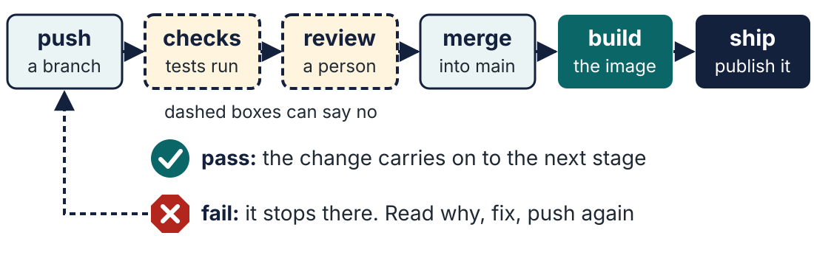
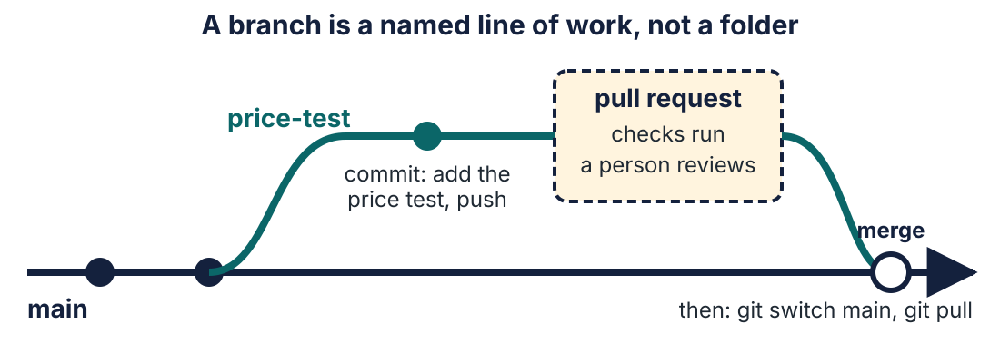
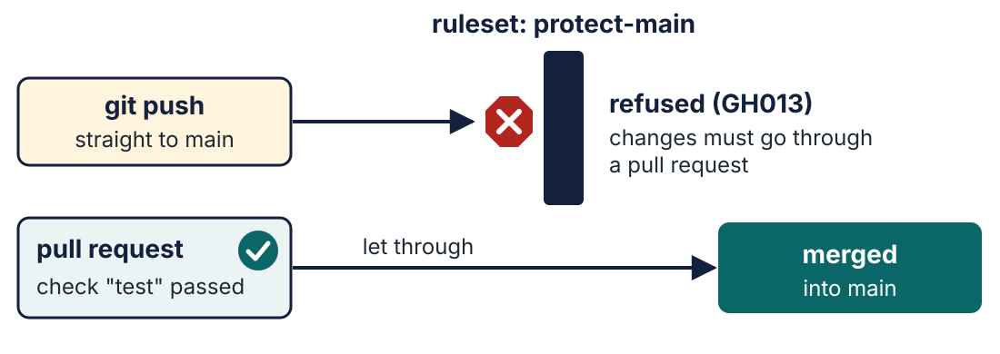

<!-- _class: lead -->
<!-- _paginate: false -->

# Nobody Breaks It Again

## Lecture 6 · CI/CD

**Tests · the loop · a gate that says no · review · ship · an AI that drafts, and CI that judges**

<span class="small">Slides, demos, exercise and labs: `lectures/06-ci-cd/`</span>

<!--
0:00. Welcome. Last week we put the menu in a box that just runs (Lecture 5). Today: how to make sure nobody breaks it on the way to that box.
Accessibility: these slides are also on Moodle/GitHub as HTML (screen-reader friendly, zoomable) and PDF.
-->

---

# Today

**In one line:** build a gate, so every change is tested and checked before it ships.

| Time | What | Where to find it |
|---|---|---|
| 4 min | Dan's message, why CI/CD, the pipeline | |
| 24 min | **Steps 1 to 6**: tests, the loop, a gate, review, ship | Demo guides 1 to 3 |
| 7 min | **Three Mentimeter questions** during the demos | menti.com |
| 6 min | Habits, gotchas and the labs | |
| 8 min | **Attendance form** and **anonymous feedback** | QR codes at the end |

<!--
0:00 to 0:04 covers this slide to the pipeline picture: keep it moving. About 34 minutes of teaching, 7 of Mentimeter and 8 of forms. The exercise is Part 0 of each lab, not in the lecture. Everything I type is in the demo guides: follow along or just watch.
-->

---

# Tuesday, 08:40: a message from Dan

> **From:** Dan · **Subject:** Who checked this? 🔍
>
> At 08:31 Mei added the autumn special to the menu and pushed it straight to `main`. Tom rebuilt the box. Staging now shows a price the till can't read: **£4.5O**, with a letter O. Morgan Lee has just tried to order one.
>
> Nobody ran the tests, and no test looked at prices anyway. I asked this three weeks ago: **how do we make sure nobody breaks it again?**

**Jordan:** "Tom has put the old menu back. From today, nothing reaches `main` without a test, a second pair of eyes and a green tick. **Build me the gate.**"

<!--
Dan's message is verbatim from the plan (section 2), with the sign-off dropped to fit. Say: Mei is not in trouble. One person, one typo, no checks: the process failed, not Mei. Every one of you will push a typo one day; the question is whether a machine catches it at 08:31 or Morgan Lee catches it at 08:40. Joke: the till can read many things. A letter O is not one of them.
-->

---

# By the end you'll be able to…

1. **Run** a project's tests, and add a **regression test** for a bug
2. Take a change **round the loop**: branch, commit, push, pull request, merge
3. Read and write a **GitHub Actions workflow**
4. Read a **failed check's log** and fix the cause
5. **Review** a change, and lock `main` with a **ruleset**
6. **Build and publish** an image automatically once the tests pass
7. Use an **AI** to write, read and review, with **CI as the judge**

<!--
Seven outcomes, the same as the README. GitHub Actions is the vehicle, not the point: UK job adverts name "CI/CD" far more often than any one tool. The ideas move with you to Jenkins or GitLab (appendix).
-->

---

# Why bother? The evidence

| Source | Finding |
|---|---|
| Stack Overflow Developer Survey, 2023 | **71.93%** of professional developers' companies have CI/CD; **60.79%** have automated testing |
| Stack Overflow Developer Survey, 2026 | In a typical week, **66.7%** review code and **51.1%** write or maintain tests |
| Hilton et al., ESEC/FSE 2017 | Fixing a **failed CI build** is the top barrier for **50%** of 523 developers |
| DORA, AI-assisted Software Development, 2025 | AI raises delivery throughput but **still increases instability** |

Today you break a build **on purpose**, so your first one at work isn't a surprise.

<!--
Sources: Stack Overflow 2023 (41,783 professional developers, the last edition that asked; read raw). Stack Overflow 2026 typical week (n=24,714): plan section 5.7 says read raw; the evidence file marks it with a dagger, so re-check the live page before the lecture. Hilton et al. 2017 (read raw). DORA 2025 report p.4 (read raw): AI adoption improves throughput but still increases delivery instability; the benefits depend on small batches and good tests, which is today.
-->

---

# The pipeline: from push to ship



**CI** (continuous integration): every change is tested and checked. **CD** (continuous delivery): what passes is built and shipped by a machine.

<!--
0:03. One picture for the whole hour. We build it left to right: Steps 1-2 push, Step 3-4 checks, Step 5 review and the gate, Step 6 build and ship. Point at the octagon: a fail stops the change and sends you back to push. Shape and word, not just colour.
-->

---

<!-- _class: act -->

# Act 1
## "Dan's promises"
Steps 1 and 2: tests on your laptop, then one trip round the loop

<!--
0:04. Repository: your fork of novastack-hq/novastack-menu, synced (Demo 0). Lecture 5's box, plus Dan's tests.
-->

---

# Step 1: a test is a promise a machine can check

Dan wrote five promises in `tests/test_menu.py`:

| Test | Promise |
|---|---|
| `test_home_page_loads` | The home page answers **200** |
| `test_health_says_ok` | `/health` says `{"status": "ok"}` |
| `test_menu_is_json_for_scripts` | `/menu` lists every item as JSON |
| `test_every_item_has_the_five_fields` | sku, name, category, price, icon |
| `test_skus_are_unique` | No two items share a SKU |

**Not one of them looks at a price.** That's how 4.5O got through.

<!--
0:04. Open tests/test_menu.py in VS Code. Show one test in full (test_skus_are_unique: three lines). The client fixture is Flask's test client: it asks the app for pages without starting a server. Dan doesn't trust anyone; that's his job, and now it's written down where a machine can read it.
-->

---

<!-- _class: demo -->

# Step 1: run the promises

```bash
uv sync
uv run pytest
```

```text
collected 5 items
tests/test_menu.py .....                                  [100%]
5 passed in 0.52s
```

- `uv sync` installs what `uv.lock` lists, **pytest included**
- `uv run pytest` finds `tests/`, runs every `test_` function, one dot each
- pip route: install `requirements-dev.txt`, then `python -m pytest`

<!--
Demo 1, Step 1. pip route in full: python -m pip install -r requirements-dev.txt, then python -m pytest. Output trimmed to fit (the header lines and blank lines are cut). Real output from VERIFIED-VALUES.md (10 Nov, lecturer's MacBook: 5 passed in 0.52s, first run); the time will differ on the day. Five dots, five promises kept. Ask: will these tests catch Mei's 4.5O? No. So Step 2 adds the promise that was missing.
-->

---

# Step 2: the loop



Every step today is **one trip round this loop**. You'll see it four times.

<!--
0:06. Draw attention to the caption in the picture: a branch is a named line of work, not a folder. Your files don't move or copy anywhere: Git just remembers which line of work you're on. (Isomöttönen and Cochez 2014: "branches are folders" is the commonest misconception, so say it.)
-->

---

<!-- _class: demo -->

# Step 2: the promise that was missing

Paste at the end of `tests/test_menu.py`, with `import re` at the top:

```python
MONEY = re.compile(r"\d+\.\d\d")  # two digits after the point: 4.50, 12.00

def test_every_price_is_money():
    for item in MENU:
        assert MONEY.fullmatch(item["price"]), (
            f"{item['sku']} {item['name']}: "
            f"price {item['price']!r} is not money like '4.50'"
        )
```

A **regression test**: a test for a bug that already happened, so it can't come back quietly. `uv run pytest`: **6 passed** on today's (restored) menu.

<!--
Demo 1, Step 2. On the slide one blank line is dropped between MONEY and the function to save space; the file has two (PEP 8). The message names the SKU, the item and the bad value: write the failure message for the person reading the log at 08:40. Begel and Simon 2008: a new graduate's first bug fix includes a regression test. Optional proof: change one price to 4.5O, run, see it fail, undo.
-->

---

<!-- _class: demo -->

# Step 2: the six commands you'll use every day

| Command | Means |
|---|---|
| `git switch -c price-test` | Start a branch: a named line of work |
| `git status` | What has changed? **Look here first** |
| `git add tests/test_menu.py` | Choose the file to save, **by name** |
| `git commit -m "test: ..."` | Save a snapshot, with a message |
| `git push -u origin price-test` | Send the branch to GitHub |
| `git switch main`, then `git pull` | Come home after the merge |

On GitHub: open the pull request (⚠️ **base: your own fork**), merge.

<!--
Demo 1, Step 2. The full commit message is "test: every price must be money (regression test for ORD-381)"; shortened to "test: ..." on the slide. Never `git add .` today: name the file, so nothing you didn't mean (a .env, say) sneaks in. git push prints a link to open the pull request: click it. On a fork GitHub pre-selects novastack-hq as the base: change it to your fork (collaborators only can open pull requests upstream anyway). 0:10: Mentimeter next.
-->

---

<!-- _class: menti -->

# Mentimeter question 1 of 3
<div class="menti-grid">
<div>


**Predict:** to run your tests, GitHub starts **a fresh machine**. What is **already on it**?

1. Everything on your laptop
2. Your code and its packages, but no Python
3. An operating system and common tools, but not your code or its packages
4. Nothing at all, not even an operating system

</div>
<div>


<p class="join"><strong>menti.com</strong><br>code <strong>8539 2729</strong></p>

</div>
</div>


<!--
0:10. Join code 8539 2729 and QR (menti.com/aljpr1g8szq2) added 17 Nov 2026; the code expires 19 Nov (re-copy from Participant sharing if reused). A prediction: they haven't seen a workflow yet. 60 seconds to vote, then the answer.
-->

---

# Question 1: the answer is 3, the tools but not your code

| Option | Why |
|---|---|
| Everything on your laptop | It has **never seen** your laptop |
| Code and packages, no Python | The opposite: Python is there, your code isn't |
| **3. An OS and tools, not your code (correct)** | **A fresh Linux machine with Git, Python and Docker.** Your code arrives when a step copies it; your packages when a step installs them |
| Nothing at all | `runs-on` chooses its operating system |

> Same lesson as Lecture 5: **the machine starts empty, just as the box did.** The workflow file writes down everything it needs.

<!--
0:11. Don't state a version: ubuntu-latest moves as GitHub updates it (VERIFIED-VALUES.md has the one it ran on 10 Nov). Say "a fresh Linux machine". Link back: in Lecture 5 the box said "No module named 'flask'". The exercise (Part 0 of each lab) meets exactly that error again.
-->

---

<!-- _class: act -->

# Act 2
## "A gate that says no"
Steps 3 to 5: a robot that runs the tests, a red cross, a review and a lock

<!--
0:12. Robots don't get bored of running tests. People do, usually at 08:31.
-->

---

# Step 3: ask an AI for a robot

In Copilot Chat (**Ask** mode), attach `pyproject.toml` and `tests/test_menu.py`, then:

```text
Write a GitHub Actions workflow for this project. It uses uv and
Python 3.12. Run the tests with pytest on every pull request and
on every push to main. Add a comment above every key explaining
what it does.
```

**Read it. Can you explain every line?** Watch the uv action's version: there is **no `@v10` tag**. Save as `.github/workflows/ci.yml` on a branch `add-ci`.

<!--
Demo 2, Step 3. Role 1 of 3: the AI as author. Run it live. A good AI usually writes a working workflow: if it does, say so, then "here's one I saved earlier" (extras/ci.step3.yml). Never claim the live AI made a mistake it didn't make. The likely real slip is astral-sh/setup-uv@v10 (no such tag since v8.0.0): if it happens, it's a true teaching moment, not a planted one.
-->

---

# Step 3: the workflow, part 1: when to run

```yaml
# Runs Dan's tests on every pull request and on every push to main.
name: CI

# When to run.
on:
  pull_request:
  push:
    branches: [main]

# What the job may do with the repository: read it, nothing more.
permissions:
  contents: read

jobs:
```

<!--
Demo 2, Step 3. The saved file, extras/ci.step3.yml, word for word. YAML: indentation is meaning, like Python. `on` = the triggers. `permissions` = least privilege: this job can read the code and nothing else.
-->

---

# Step 3: the workflow, part 2: the job

```yaml
  # One job, called "test". Its name is what a ruleset asks for.
  test:
    # A fresh Linux machine from GitHub. It starts empty, like a container.
    runs-on: ubuntu-latest
    steps:
      # Copy the repository onto the machine.
      - uses: actions/checkout@v7
      # Install uv. This action has no moving "v10" tag,
      # so pin the exact version.
      - uses: astral-sh/setup-uv@v10.3.3
      # Install exactly what uv.lock lists, pytest included.
      - run: uv sync --locked
      # Run the tests. One failing test fails the whole job.
      - run: uv run pytest
```

<!--
Continues from `jobs:` on the previous slide; word for word as extras/ci.step3.yml. `uv sync --locked` fails if uv.lock is out of date: good for CI. Caching for uv is on by default on GitHub's machines.
-->

---

<!-- _class: demo -->

# Step 3: five ideas, then the first green tick

| Idea | In our file | Means |
|---|---|---|
| `on` | `pull_request`, `push` | **When** to run |
| `jobs` | `test` | A named piece of work. The ruleset asks for it by name |
| `runs-on` | `ubuntu-latest` | **Which machine**: fresh and empty every time |
| `steps` | four | In order. **One failure stops the job** |
| `uses` / `run` | `actions/checkout@v7` / `uv run pytest` | Someone else's step / a shell command |

Round the loop on `add-ci`. Checks box: **✅ All checks have passed**. My laptop's job, on a machine nobody owns.

<!--
0:14. Commit message: "ci: run the tests on every pull request and push to main". git add .github/workflows/ci.yml (named file). On the pull request, the check appears as "CI / test (pull_request)". On the instructor's fork the first run took 11 seconds (VERIFIED-VALUES.md, rehearsal 11 Nov). The log shows a harmless line, "Could not determine uv version from uv.toml or pyproject.toml. Falling back to latest.": say it is harmless before someone asks. The box says "All checks have passed / 1 successful check". Pushing the branch starts nothing; opening the pull request does. Merge it: from now on every pull request is tested.
-->

---

<!-- _class: demo -->

# Step 4: Mei's change, again

On a branch `autumn-special`, the last item of `menu.json`:

```json
  {
    "sku": "D05",
    "name": "Pumkin spice latte",
    "category": "drink",
    "price": "4.5O",
    "icon": "🎃"
  }
```

**Planted on purpose.** Two problems hide in there. Can you see both?

<!--
0:16. Demo 2, Step 4. Say it is planted. Remember the comma after the previous item. Commit "feat: add the autumn special (ORD-381)", push, open the pull request (base = your fork). Don't reveal the second problem (the spelling): Step 5 needs it.
-->

---

<!-- _class: demo -->

# Step 4: the red cross

On the pull request: **❌ All checks have failed**. Details → the log, near the end:

```text
tests/test_menu.py .....F                                 [100%]
E   AssertionError: D05 Pumkin spice latte:
      price '4.5O' is not money like '4.50'
FAILED ...::test_every_price_is_money - AssertionError: D05 ...
1 failed, 5 passed in 0.30s
```

The merge button still works. **Nothing stops Mei yet.** That's Step 5.

**Paused here.** Which line would you read first?

<!--
0:17. Pause. Don't explain the log yet: Mentimeter question 2 is asked with this on screen. Lines from the rehearsal's CI log (VERIFIED-VALUES.md, 11 Nov), trimmed: the FAILED line's path and message shortened and the E line wrapped to fit. In CI pytest prints the FAILED line whole (it detects CI); on a narrow laptop terminal it cuts it ("... D05 Pu..."). Either way the E line has the whole message: point at it. The step ends with "Process completed with exit code 1." The box says "All checks have failed / 1 failing check", next to "CI / test (pull_request) Failing after" a few seconds.
-->

---

<!-- _class: menti -->

# Mentimeter question 2 of 3
<div class="menti-grid">
<div>

```text
E   AssertionError: D05 Pumkin spice latte:
      price '4.5O' is not money like '4.50'
FAILED tests/test_menu.py::test_every_price_is_money
```

The check is red. **Most likely cause?**

1. The tests are wrong
2. GitHub's machine is broken
3. The internet connection dropped
4. The change broke something a test checks

</div>
<div>


<p class="join"><strong>menti.com</strong><br>code <strong>8539 2729</strong></p>

</div>
</div>


<!--
0:18. Ask while the log is still in the room. 60 seconds to vote.
-->

---

# Question 2: the answer is 4, a broken promise

| Option | Why |
|---|---|
| The tests are wrong | They passed on `main` a minute ago. **Suspect the newest change first** |
| GitHub's machine is broken | It would fail **before** the tests. Here pytest ran |
| The internet dropped | Same: the install worked. The failure is an `AssertionError` |
| **4. The change broke a promise (correct)** | **The log names the test, the item (D05) and the value ('4.5O')** |

> "It's GitHub's fault": tempting, almost always wrong. **Find `FAILED`, then read the whole `E` line above it.**

<!--
0:20. Hilton et al. 2017: fixing a failed build is the top CI barrier for half of 523 professional developers. Reading the log first is the whole skill.
-->

---

# Step 4: read the log, then ask the AI to read it

**1. Predict first:** "I think the problem is ___."

**2. Give the AI evidence:** paste the log **and** the diff.

```text
This check failed. Here are the log and the diff. What is wrong,
and what is the smallest change that fixes it?
Log: <paste from FAILURES down to the summary line>
Diff: <paste the output of git diff main>
```

**3. Compare**, then fix `"4.5O"` → `"4.50"`, commit, push: **✅ test: passed**.

<!--
0:21. Demo 2, Step 4. Role 2 of 3: the AI as reader. Say your own diagnosis out loud first. Paste the text, from the FAILURES heading down, so the whole E line goes in (on a narrow laptop terminal the FAILED line is cut short): attaching a file doesn't send the log (Lecture 5 lesson). Check the answer quotes the log. Commit message: "fix: the autumn special costs 4.50". The check re-runs on its own when you push to the same branch.
-->

---

# Three habits for working with an AI

| Role | Prompt | How we proved it |
|---|---|---|
| **Author** | "Write a workflow for this project" | Pushed it: green tick |
| **Reader** | "Here are the log and the diff. What is wrong?" | Pushed the fix: green |
| **Reviewer** | "Review this change. At most three problems" | Applied one: still green (next) |

1. Give it **evidence**, not a guess
2. Ask for a **short list**
3. **Prove it.** CI is the judge, and it doesn't do favours.

<!--
0:23. Same rule as Lectures 3 to 5: AI is a lead, not an oracle. Stack Overflow 2026: 76.5% of developers run an AI answer before using it (n=13,162; plan 5.7, re-check live). CI makes "prove it" automatic.
-->

---

<!-- _class: demo -->

# Step 5: a second pair of eyes

The check is green. Is the change **right**?

```text
Review this change. Give me at most three problems,
most important first.
```

Typical answers: **"Pumkin" is misspelt** · no test checks names · the icon may not show on the till.

We apply **one**: `Pumkin` → `Pumpkin`, commit, push. Still green. **Merge.**

> A test checks what someone wrote down. Nobody wrote down "pumpkin has a p".

<!--
0:24. Demo 2, Step 5. Role 3 of 3: the AI as reviewer. If behind, don't wait for Copilot: read the typical answers from the slide. TODO(Copilot trials, not the fork rehearsal): confirm the typical answers against the Copilot trials (COPILOT-TRIALS) and change them to what Copilot really says. Copilot's review on the pull-request page is in Copilot Student, not Free: mention in one line. Commit: "fix: spell pumpkin correctly". Bacchelli and Bird 2013: only 14% of review comments are defects; review is mostly about understanding and team norms. Google's median change is 24 lines (Sadowski et al. 2018): small changes get good reviews.
-->

---

# Step 5: then lock the door



Settings → Rulesets → **New branch ruleset**: `protect-main`, **Active**, default branch, **Require a pull request** (0 approvals) and **status checks**: `test`.

<!--
0:26. Demo 2, Step 5. 0 approvals so a solo fork can still merge; a real team would ask for 1. The check "test" is offered only after it has run once (it has, in Step 3). Nobody bypasses unless listed: even the lecturer can't push to main now. Especially the lecturer.
-->

---

<!-- _class: menti -->

# Mentimeter question 3 of 3
<div class="menti-grid">
<div>


**Predict:** `main` now needs a pull request and a green check. You push **one small commit straight to `main`**. What happens?

1. It goes in, with a warning
2. GitHub refuses the push
3. It goes in, and the check runs afterwards
4. Git refuses to make the commit

</div>
<div>


<p class="join"><strong>menti.com</strong><br>code <strong>8539 2729</strong></p>

</div>
</div>


<!--
0:28. A prediction. 60 seconds to vote, then do it live: git switch main, git pull, git commit --allow-empty -m "chore: just this once", git push.
-->

---

# Question 3: the answer is 2, GitHub refuses the push

The commit is made on your laptop (Git is happy). **GitHub refuses the push**, before anything lands on `main`. A gate that apologises afterwards isn't a gate.

```text
remote: error: GH013: Repository rule violations found for refs/heads/main.
remote: - Changes must be made through a pull request.
remote: - Required status check "test" is expected.
 ! [remote rejected] main -> main
   (push declined due to repository rule violations)
```

Undo the local commit: `git reset --hard origin/main`. ⚠️ It throws away **every** local change on that branch.

<!--
0:29. The refusal as seen on the instructor's fork (11 Nov), with the "Review all repository rules at ..." line, blank remote: lines and the final "error: failed to push some refs" line left out, and the last line wrapped to fit. Explain reset --hard: move my main back to GitHub's main, files too. Safe here because the commit was empty; dangerous with work you haven't pushed.
-->

---

<!-- _class: act -->

# Act 3
## "From green to shipped"
Step 6: after the merge, a machine builds Lecture 5's box and publishes it

<!--
0:31.
-->

---

<!-- _class: demo -->

# Step 6: a second job builds and publishes the box

`cp extras/ci.step6.yml .github/workflows/ci.yml`, round the loop on `ship-it`:

```yaml
  publish:
    needs: test                # only after the tests pass
    if: github.event_name == 'push' && github.ref == 'refs/heads/main'
    runs-on: ubuntu-latest
    permissions:
      contents: read
      packages: write          # may publish images to ghcr.io
    steps:
      - uses: actions/checkout@v7
      - run: docker login ghcr.io ...      # with the GITHUB_TOKEN
      - run: docker build -f Dockerfile.step5 -t "$IMAGE" .
      - run: docker push "$IMAGE"
```

<!--
0:31. Demo 3, Step 6. Shortened for the slide: the real file (extras/ci.step6.yml) names its steps, logs in with a two-line run block, and sets IMAGE to ghcr.io/owner/repo, lower case, tagged with the first 7 characters of the commit; it writes "Published <image>" to the job summary. Proven on the instructor's fork (11 Nov): test 12 s, then publish 13 s; summary "Published ghcr.io/moodyalam/novastack-menu:7ca59b1". The same docker commands students typed in Lecture 5, now typed by a machine. `if`: only on a push to main, so a pull request never publishes. packages: write is needed because a new repository's token is read-only for packages. Commit: "ci: publish the box after the tests pass on main". If behind, show the rehearsal's publish run instead of waiting.
-->

---

<!-- _class: demo -->

# Step 6: Tom pulls the box

After the merge, the Actions tab shows **test** then **publish**, and the summary says where the image went:

```bash
docker pull --platform linux/amd64 ghcr.io/<you>/novastack-menu:<sha>
docker run -d -p 8000:8000 --platform linux/amd64 \
  ghcr.io/<you>/novastack-menu:<sha>
```

- `<you>` your GitHub name in lower case · `<sha>` the first 7 characters of the merge commit
- Open **localhost:8000**: the menu, with **Pumpkin** spelt right and **£4.50**

> **Tom:** "Same commands as last week. Except nobody had to message me."

<!--
0:33. Demo 3, Step 6. The guide adds "; echo http://localhost:8000" after docker run -d for a clickable link (left off to keep the text large). --platform linux/amd64: the robot builds amd64 only, and on an Apple-silicon Mac a plain docker pull fails with "no matching manifest for linux/arm64/v8" (seen in rehearsal); elsewhere it changes nothing. The package came out Public (linked to the public fork), so no docker login is needed; a public package can't be made private again. A fork's own token can push to its owner's ghcr.io (proven 11 Nov). Continuous delivery: the box is ready to ship; deploying it to staging is still Tom's decision (continuous deployment would do that too).
-->

---

# Habits that save you later

| Habit | Why |
|---|---|
| **Pin actions** to a full commit SHA | tj-actions (March 2025): a moved tag hit **over 23,000** repositories. Trivy action (March 2026): **76 of 77** tags force-pushed |
| **Least privilege**: `permissions: contents: read` | The token can do only what the job needs (GitHub's secure-use reference) |
| **Secrets** in GitHub's secret store | Never in the workflow file, a log or an AI chat |
| **Small pull requests** | Google's median change is **24 lines** (Sadowski et al., 2018); review under **200 to 400** lines (Cisco/SmartBear, 2006) |

<!--
0:34. Step 7 in Demo 3 is written up: pinning, permissions, secrets, caching, a matrix. Workflow lockfiles (gh actions-lock, generally available 28 Oct 2026) supersede SHA pinning where adopted: one line if asked; SHA pinning is the assessed habit in the Intermediate lab. Step 8 (written): merge conflicts in VS Code's merge editor.
-->

---

# Gotchas to know before the labs

- **No check at all? Silence isn't green.** Actions tab: if it asks, enable workflows
- **Check the pull request's base repository.** On a fork GitHub picks `novastack-hq`: choose **your fork**
- **Apple-silicon Mac?** `docker pull --platform linux/amd64`: the robot builds `amd64` only
- **The uv action has no moving tag.** `setup-uv@v10` fails: write `@v10.3.3` (or the SHA)
- **A ruleset offers a check only after it has run once**

<!--
0:36. Each of these has cost someone an hour. All are in the demo guides (Demo 0's troubleshooting table, Demo 2 Goals 3.5 and 3.7, Demo 3 Goal 6.6). Seen on the fork (11 Nov): setup-uv@v10 fails in Set up job with "Unable to resolve action `astral-sh/setup-uv@v10`, unable to find version `v10`"; an arm64 pull fails with "no matching manifest for linux/arm64/v8". A fork of novastack-menu has no workflows, so its Actions tab shows "Get started with GitHub Actions" (Actions already on); the switched-off banner appears only on forks of repositories that have workflows.
-->

---

# Epilogue: one minute, not one morning

> **Mei** opens a pull request for the winter special. The check goes **red on a typo** before anyone else sees it; she fixes it in a minute.
>
> **Dan:** "First time a mistake has cost us one minute instead of one morning."
>
> **Jordan:** "Next: the data behind the menu."

<!--
0:37. From the plan, section 2. The hook for the later SQL lecture: don't give it a number.
-->

---

# Before the labs

- **Exercise ORD-384** is Part 0 of every lab (10 minutes, in pairs): fill three blanks in a workflow, then fix a red run. It meets an old friend: `No module named 'flask'`
- **Beginner (ORD-385):** *Your First Green Tick* · **Intermediate (ORD-386):** *Make It Production-Shaped* · **Advanced (ORD-387):** *Bring CI to Orders*
- Check yourself: `uv run tools/check_lab6.py beginner` (or `intermediate`, `advanced`)
- Start with **Demo 0**: sync your fork, enable Actions. Every step is in `lectures/06-ci-cd/demo/`

<!--
0:38. The exercise's red run: the file installs pytest but not the app's packages, so the machine starts empty, just as the box did. One line fixes it. The Advanced lab is in a fork of novastack-orders and meets XPASS(strict) from Lecture 3.
-->

---

# Two short forms, please (about 8 minutes)

<div class="cols">
<div>

**1. Attendance and survey**
University sign-in · about 5 minutes


</div>
<div>

**2. Anonymous feedback**
No names recorded · about 2 minutes


</div>
</div>

Can't scan? Both links are on Moodle. Taking part in the research is **voluntary** and doesn't affect your place on the programme. Every question has an **N/A** option.

<!--
0:40. Forms built 11 Nov 2026 and QR codes added. Post both links on Moodle. Attendance form is open only 17:30 to 18:15 on 17 Nov; feedback form until 17:45 on 27 Nov. Never cut the forms.
-->

---

<!-- _class: lead -->
<!-- _paginate: false -->

# Thank you

## Questions?

<span class="small">Remember: a green tick doesn't mean the code is right. It means it kept every promise someone wrote down. So write more promises.</span>

<!--
0:48.
-->

---

# Appendix: not today, but you will meet them

| Name | One line |
|---|---|
| **Jenkins** | A CI server you run yourself. Older, still common in big companies |
| **GitLab CI** | GitLab's pipelines: a `.gitlab-ci.yml` file, the same ideas as today |
| **Deployment environments and approvals** | Named targets (staging, production); a person approves before the job runs |
| **Feature flags** | Ship code switched off; turn it on later without a new release |

> JetBrains' *State of CI/CD* 2026 (598 developers): GitHub Actions **47%**, GitLab CI **32%**, Jenkins **28%** of organisations. The tool changes; the ideas don't.

<!--
Appendix: not shown in the 50 minutes unless someone asks. JetBrains/TeamCity is a vendor survey of engaged developers, not the whole industry (read raw, evidence file). A quarter of organisations use two or more CI/CD tools.
-->
